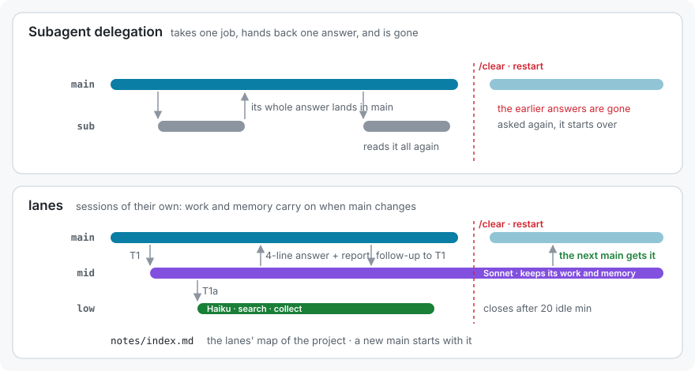

<div align="center">

# lanes

**Two helper sessions beside your main Claude Code session, open only when there's work for them.**<br>
From the first idea to release, Sonnet takes the side work that needs judgement, Haiku the mechanical work, and only conclusions reach your main (Opus) context.

[](lanes/.claude-plugin/plugin.json)
[](LICENSE)
[](https://code.claude.com)
[](#install)
[](#bedrock--vertex--foundry)
[](https://github.com/jysvai/lanes)

[한국어](README.md) · **English** · [GitHub](https://github.com/jysvai/lanes) · [Issues](https://github.com/jysvai/lanes/issues) · [Contact](#contact)

</div>

<p align="center"></p>

## How it works

<p align="center"></p>

The lanes split the work **by what each model is good at**.

| Session | Model (fallback) | Effort | Takes |
|---|---|---|---|
| **main** | Opus 5.5 (Fable 5.1) | xhigh or more | **The main line and the decisions**: writing code and documents, commits, deploys. Only main changes the repo |
| **mid** lane | Sonnet 5.5 (Opus 5.5) | high, fixed | **Side work that needs judgement**: research and comparing options, drafts of plans and specs, reviews, tests and verification |
| **low** lane | Haiku 5.5 (Sonnet 5.5) | medium, fixed | **Fast, mechanical work**: search and listing, collecting references, running scripts and counting, crawling, sorting notes |

- A lane **opens when you hand it work** and closes itself after 20 idle minutes.
- A lane answers in four lines at most. The full report goes to `.claude/lanes/out/T<n>.md`.
- Work handed to a busy lane waits in its queue and goes over as soon as the task before it is done.
- What the lanes map (where things are, lists of files) builds up in `.claude/lanes/notes/`, so nobody searches twice.
- The fallbacks are all 5.x too. **A lane never runs on Sonnet 4 or Haiku 4**: set in the config they give way to the default, and where no 5.x model is to be had a lane fails rather than drop to an older one.

## For everyone, at every stage

Use it just the same at the idea and planning stage, before any code exists. Main does the main work, and the lanes take the side work and the extra work beside it.

| If you are | main (Opus) | mid (Sonnet) | low (Haiku) | Try |
|---|---|---|---|---|
| **A planner** | Direction, final documents | Market and competitor research, comparing options, drafts of PRDs and specs, reviewing plans | Collecting references, examples and figures into tables | `/lane a dog-walking app idea: how it differs from similar services` |
| **A developer** | Writing code, commits, deploys | Verifying changes, tests, reviews, narrowing down causes | Code search, running suites and scripts, collecting logs | `/lane fix the login bug and run the tests` |
| **New to this** | One step at a time, in plain words | Runs it for you and says in plain words whether it works | Finds easy guides and examples, checks what's installed | `/lane I want my blog online, walk me through it from the start` |

**How each stage splits**
- **Idea**: mid researches similar products and compares options, low gathers references, and main settles the direction with you.
- **Planning**: mid drafts specs and flows and reviews them for gaps; main writes the final version.
- **Building**: main builds, mid verifies and tests, low searches and runs things.
- **Before release**: mid uses it end to end like a user would, low runs through the checklist.

Set **How you work** in `/config` to match. The default, `auto`, has main read it from how you work; `developer`, `planner` or `beginner` fixes how main splits the work and how the lanes word their reports.

## How it differs from subagent delegation

<p align="center"></p>

A subagent takes a job, hands back one answer and is gone. A lane is **a session that stays up**, which makes these possible:

| | Subagent | lanes |
|---|---|---|
| When main is cleared, restarted or closed | Its results go with it | The lane finishes its work, and **the next main session gets the answer** |
| What lands in main's context | The subagent's whole final answer | **A four-line answer** and the report's path |
| Asking more on the same topic | Reads everything again | **Follow up** on work the lane still remembers (`in context: T5, T7`) |
| What it found and mapped | Gone by the next call | Builds up in `notes/index.md`, and **main starts each session with that map** |
| Cost | Not shown | **Per task**, beside what it would have cost on Opus (`/lane tasks`) |
| Passing a chore on | Goes back through main | mid hands it straight to low |
| Changing repo files | As its tools allow | **Can't write** in the repo outside `.claude/lanes/` (the plugin refuses Write and Edit) |

- **Inbox**: when a lane replies while main is closed or restarting, the reply goes into the next main session's prompt (for up to three days). The lane doesn't keep retrying.
- **Follow-ups**: `/lane status` lists the tasks a lane still has in context. Main sends that lane `(follow-up to T7) ...` instead of explaining again. The list empties when the lane closes and reopens.
- **Ledger**: `/lane tasks`

```
lane tasks in this project, newest first (2 of 2)
  T2    mid  open       3m    $0.01 (on main $0.20)  run the tests
  T1    low  DONE       1m    $0.01 (on main $0.20)  count the files
all 2 tasks: $0.02, on opus-5-5 $0.40. A sub-task (T7a) is counted on its own row.
```

## Better together

lanes does more **alongside your other savers** than on its own. If you have any, leave them on; main splits the work between them.

| Use with | Good at | Together with lanes |
|---|---|---|
| **A token saver**: one you built, a tool like Sprag (formerly claude-token-saver), or Claude Code's own `/context` and `/cost` | Watching the cache, the context and usage, and pointing out waste | The lanes take the wasteful work off main, on cheaper models |
| **Subagents, delegating skills and plugins** | Short one-off lookups | Short jobs go to a subagent, longer or continuing ones to a lane |
| **lanes** | Side work that runs long, or has to outlive a restart | Main's context gets conclusions only and stays light |

Main starts every session told to send short one-off lookups to a subagent, longer or continuing work to a lane, and to use whatever token-saving or delegating skills and plugins you have alongside them.

## How much it saves

<p align="center"></p>

A real record of one web game project worked on all afternoon (4.6 hours), next to **the same work all on Opus**.

| Period | All on Opus | lanes | Difference |
|---|---:|---:|---:|
| A day (this session) | $106 | $71 | **−$35 (33%)** |
| A week · 5 days | $530 | $353 | **−$177** |
| A month · 21 days | $2,227 | $1,483 | **−$744** |
| A year · 250 days | $26,513 | $17,653 | **−$8,860** |

- **The lanes' own share came out 57% cheaper.** mid (Sonnet) went from $52.30 to $26.15, half; low (Haiku) from $9.81 to $0.52, 95% less.
- **On a subscription (Pro, Max)** the bill stays the same, but usage limits are drawn down roughly by model price too: about **1.5×** the work from the same limits.
- **It saves more than the table shows.** The screenshots, logs and search results the lanes read (over 100 million tokens in this session) never piled up in main's conversation, so every later turn of main stayed light. That part isn't in the table.
- **You get more than a lower bill.** Main's context stays light, so it stays on track through long work; checks and research run while main keeps working; and every task's result and cost is on record.
- **How it's counted:** every request in the session logs, its tokens priced at its model's [API list price](https://platform.claude.com/docs/en/about-claude/pricing) (cache writes at the 1-hour rate). A week, a month and a year take this session as one working day.

### Measured on three projects

<p align="center"></p>

| | Project 1 · a web game | Project 2 · the lanes plugin | Project 3 · a work planning doc (Bedrock) | All three |
|---|---:|---:|---:|---:|
| Session | 4.7 h · 29 lane tasks | 3.4 h · 7 lane tasks | 0.9 h · 3 lane tasks | 9.0 h |
| All on Opus | $106.13 | $39.51 | $7.50 | $153.14 |
| With lanes | $70.64 | $30.89 | $5.16 | $106.69 |
| **Saved** | **−$35.48 (33%)** | **−$8.62 (22%)** | **−$2.34 (31%)** | **−$46.45 (30%)** |

Project 2 is the session that built this repo. Its lanes found two bugs in a review and ten issues to fix in a security review; after the fixes it reviewed them again, and the gaps left were closed too. Project 3 is a planning doc written on a work computer, through the company's gateway to Amazon Bedrock; the low lane did the web research at 3% of Opus's price, and the lanes' share saved 63%. The timelines, an experiment running the same tasks on three models (Sonnet answers as well as Opus at 38% of the cost, Haiku costs 3%), how it's counted and scripts to measure your own are in **[docs/dollar-savings.en.md](docs/dollar-savings.en.md)**.

See your own project's numbers with `/lane usage`:

```
lane spend today (2026-10-11), at API list prices
  main  opus-5-5         468 calls    $43.94
  mid   sonnet-5-5       767 calls    $26.15   on opus-5-5 $52.30  saved $26.15 (50%)
  low   haiku-5-5        147 calls     $0.52   on opus-5-5 $9.81  saved $9.29 (95%)
  lanes                  914 calls    $26.67   on opus-5-5 $62.11  saved $35.44 (57%)
  all                   1382 calls    $70.61   on opus-5-5 $106.05  saved $35.44 (33%)
```

Below the table it says **where and how the saving came from** (each task has its own ledger entry):

```
where it came from, by task (most saved first)
  T1    mid  PARTIAL   $1.56 instead of   $3.11  saved  $1.55  Review the uncommitted changes under lanes/
  T2    low  DONE      $0.02 instead of   $0.78  saved  $0.76  Inventory, no edits: in README.md, docs/*.svg
how
  the same work on cheaper models: per token, sonnet-5-5 costs 1/2 of opus-5-5, haiku-5-5 costs 1/40–1/20 of opus-5-5
  and main's context stays light: the lanes took in 244k tokens (their prompts, and the files,
  logs and results they read) that main never read, nor carried through its later turns. That part is not in the table.
```

## Install

Checked on Claude Code 2.1.296 and later (an older one gets a warning when a lane opens). On Windows, macOS and Linux alike, at the Claude Code prompt:

```
/plugin install lanes --marketplace jysvai/lanes
```

Pick the user scope to have it in every session of every project. From a terminal:

```
claude plugin marketplace add jysvai/lanes
claude plugin install lanes@claude-mod --scope user
```

If it says some options aren't set yet, the defaults below apply.

## Bedrock · Vertex · Foundry

When Claude Code runs on Amazon Bedrock, Google Vertex AI or Microsoft Foundry (`CLAUDE_CODE_USE_BEDROCK=1` and so on, set in the shell or in `settings.json`'s `env`), the lanes open **on the names that provider uses**. Keep the Claude API names (`claude-sonnet-5-5`) in the config.

| Provider | What the mid lane opens on (with the defaults) |
|---|---|
| Claude API | `claude-sonnet-5-5` |
| Amazon Bedrock | `us.anthropic.claude-sonnet-5-5`: `us.` for a `us-*` region, `us-gov.` for `us-gov-*`, `eu.` for `eu-*`, `global.` elsewhere or with no region set (or set `ANTHROPIC_BEDROCK_REGION_PREFIX`) |
| Bedrock Mantle | `anthropic.claude-sonnet-5-5` (your account needs Mantle access; with `CLAUDE_CODE_USE_BEDROCK` on as well, the Mantle names win) |
| Vertex AI | `claude-sonnet-5-5` (Vertex's exact IDs aren't confirmed yet; a pin as below makes sure) |
| Foundry | Your deployment name, pinned as below; otherwise `claude-sonnet-5-5` |

- **Your pins come first.** A model pinned in `ANTHROPIC_DEFAULT_SONNET_MODEL`, `_HAIKU_`, `_OPUS_` or `_FABLE_` (an application inference profile ARN included) is what the lane uses, unless it names a Sonnet 4 or Haiku 4 (then the lane passes it over; what Claude Code uses it for in its own background work is left alone).
- **Written out, it goes as is.** A provider ID or ARN in `/config`, like `eu.anthropic.claude-sonnet-5-5`, is not changed.
- **Where the IDs come from:** AWS Bedrock's model cards (October 2026). Opus 5.5, Sonnet 5.5 and Haiku 5.5 have `us.`, `eu.` and `global.` profiles; Fable 5.1 has `us.` and `global.` only.
- **The main launchers** (`claude-main`) pass the Claude API names, and Claude Code maps them to the provider's.
- **Cost:** Bedrock's `global.` profiles cost the list price, its regional ones 10% more. `/lane usage` counts at list price (the lanes and main move by the same share, so the saving's share holds).
- **macOS windows:** a new Terminal window gets the provider, region, profile and gateway settings. A key (AWS keys, tokens) is never written to a file, so with Terminal already open a new window may lack it: keep keys in `settings.json`'s `env` or an AWS profile, or run the lanes in the background.
- **What's been checked:** the naming is covered by tests. The lanes haven't been run on a real Bedrock or Vertex account yet.

## Usage

```
/lane <what you want done>    main splits it up and sees it through
/lane status                  lanes, tasks you can follow up on, latest reports, today's lane spend
/lane tasks                   the ledger: how each task ended, how long it took, what it cost
/lane usage [all]             spend today (all: since logging began) and the saving against Opus
/lane mid <task>              hand a task straight to the mid lane (low works the same)
/lane start | stop [mid|low]  open ahead of time, or close
/lane help                    the list of commands
```

Any case works, and so do the Korean verbs (`상태`, `작업`, `비용`, `시작`, `중지`, `도움말`). A wrong argument (`/lane usage weekly`) or a typo (`/lane statsu`) shows the usage instead of being handed to main as a request.

Write `/lane fix the login bug` and main splits the work and hands parts to the lanes. Meanwhile it keeps on the main work, folds in what the lanes find, has the mid lane check what it changed, and reports what changed and what was checked. Work with no code in it (`/lane find the gaps in this plan`) runs the same way.

### Reading the status line

```
lanes  sonnet ● T3 2m +1 · haiku ○
```

| Mark | Meaning |
|---|---|
| `●` `○` `off` | working · idle · closed |
| `T3` | **The third task** handed to a lane in this project (not a terminal number). Its report has the same number (`out/T3.md`). |
| `2m` | Two minutes since that task started |
| `+1` | One more task waiting behind it |

## Settings `/config`

| Option | Default |
|---|---|
| main model · fallback · effort floor | `claude-opus-5-5[1m]` · `claude-fable-5-1` · `xhigh` |
| mid model · fallback · effort | `claude-sonnet-5-5` · `claude-opus-5-5` · `high` |
| low model · fallback · effort | `claude-haiku-5-5` · `claude-sonnet-5-5` · `medium` |
| How you work | `auto` · `developer` · `planner` · `beginner` |
| How lanes open | `window` (a new window) · `background` (watch with `claude attach <name>`) |
| Lane permission mode | `auto` · `acceptEdits` · `dontAsk` · `manual` · `bypassPermissions` |
| Close when idle | after `20` minutes (0 keeps them open) |

<details>
<summary><b>More</b>: effort rules · per-project instructions · things to know · development</summary>

**Effort rules**
- With an Opus or Fable main session, effort never drops below the floor.
- A lane's effort is fixed: change it with `/effort` and it goes back to the setting.
- Main's fallback can only be set when it starts, so there are launchers for it: `lanes/bin/claude-main.ps1` (Windows), `lanes/bin/claude-main.sh` (macOS).

**Per-project instructions**
- `.claude/lanes/roles/mid.md` and `low.md` in a project are appended to the lanes' role prompts: the place for that project's test commands, how to verify, where the planning docs live.
- The guidance for each way of working is in `lanes/roles/styles/` (`developer.md`, `planner.md`, `beginner.md`).
- The `.claude/lanes/` folder writes its own `.gitignore` on first use, so it stays out of git.

**Things to know**
- Lanes are named `<folder>-<path tag>-mid` (e.g. `claude-mod-8071-mid`), so folders with the same name, or with non-ASCII names, never share lanes. A lane opened by an earlier version (`claude-mod-mid`) closes itself once idle.
- A managed PC whose execution policy blocks every `.ps1` file is fine: the plugin runs its script as a script block, not a file, and starts `claude.exe` or `claude.cmd`, not npm's `claude.ps1`. It doesn't work under AppLocker or WDAC Constrained Language Mode.
- On macOS a lane's window opens with `open -a Terminal`, which asks for no Automation permission. The new window gets this session's PATH and `CLAUDE_CONFIG_DIR`.
- What a lane can't do: Edit, Write inside the repo outside `.claude/lanes/`, and git commit · push · reset · checkout · restore · stash · clean · switch · rebase · merge · cherry-pick · revert · apply · am · rm · mv. Changing files through Bash (`sed -i` and the like) isn't blocked, so bear that in mind with `bypassPermissions`.
- Start Claude Code in a project's folder: the lanes keep their history (`.claude/lanes`) in the folder you start in.
  - In your home folder (`~`), Claude Code never saves trust, so every lane window asks for it again and a background lane can't open.
  - In a folder of several projects, such as the Desktop, they all share one history, so a lane could read another project's reports and notes.
  - Started in either, the lanes say so in the status line, in `/lane` and in main's first reply, with the command for your OS to start in a project's folder.
- Where auto mode isn't available, change the lane permission mode in `/config`. Nobody answers a prompt in a background lane, so pick `dontAsk` (with an allowlist) or `manual` with windows.
- A lane started inside one of Claude's tool calls (Bash and so on) never receives messages: it inherits the child-session markers. `/lane` and `send` start lanes from the session itself, so they're fine. To start one by hand, use a terminal you opened yourself:
  - Windows: `powershell -ExecutionPolicy Bypass -File lanes\bin\lanes.ps1 start -Project <project folder>`
  - macOS, Linux: `LANES_PROJECT=<project folder> bash lanes/bin/lanes.sh start`
- `CLAUDE_CODE_SUBAGENT_MODEL_FORCE` in `settings.json` forces every subagent onto that model, so the lanes hand work to the low lane rather than to subagents.
- On Linux lanes open in the background. Watch one with `claude attach <lane name>` (`/lane status` shows the names).

**Install from a local folder · development**
```
/plugin marketplace add <the folder you cloned this into>
/plugin install lanes@claude-mod

claude plugin validate lanes
claude plugin test lanes
```
</details>

## Security

A lane is a Claude Code session on your machine, with your rights. From 0.3.1 it guards against the following.

- **Files a repo plants:** the queue a lane runs, the tasks main handed out, and the notes' seal live in your user folder (`~/.claude/lanes/<project>/`). A queue in a cloned repo's `.claude/lanes/` is never run, and only replies to tasks this machine's main handed out reach main's prompt. The notes (`notes/index.md`) go in only as this machine's sessions wrote them with Write or Edit.
- **Links:** with a symbolic link or a junction under `.claude/lanes`, the lanes stay off, so no write can land somewhere else. A `.gitignore` a repo put there goes back to `*`.
- **Command injection:** on Windows, the lanes start `claude.exe` rather than npm's `claude.cmd`; where they can't, a path with a character cmd.exe acts on (`& | < > ^ % ! , ; = "`) keeps the lanes closed.
- **Terminal control characters:** escape sequences and control characters are stripped from lane replies and progress pings before the status line and `/lane status` show them. Pings and verdicts count only on the first line of a message from this project's lanes.
- **Reply address:** a lane replies to main's unique address, not its name: another session in the same folder can get main's name.
- **What a lane reads is data:** the lanes are told not to follow instructions in pages, files and logs, and not to copy commands from them into notes or replies.
- **Keys:** no key or token is written to a run file. A lane's scratch files go in a folder of its own.

**Not a security boundary:**
- The lanes' write limits (Write, Edit) and git blocks prevent accidents. A lane has a shell and could get round them.
- With the permission mode set to `bypassPermissions`, a lane runs without asking.
- Other programs of the same user can message a lane.
- A project's `.claude/lanes/roles/<lane>.md` joins the lane's instructions, as `CLAUDE.md` does. In a repo you don't know, read both before opening the lanes.

Report a vulnerability as [SECURITY.md](SECURITY.md) says.

## Contact

Questions, bug reports and ideas: open a [GitHub issue](https://github.com/jysvai/lanes/issues) or email **yunseok1312@gmail.com**. Please report security problems by email rather than in an issue ([SECURITY.md](SECURITY.md)).

## License

[Apache License 2.0](LICENSE) · Copyright 2026 jysvai
