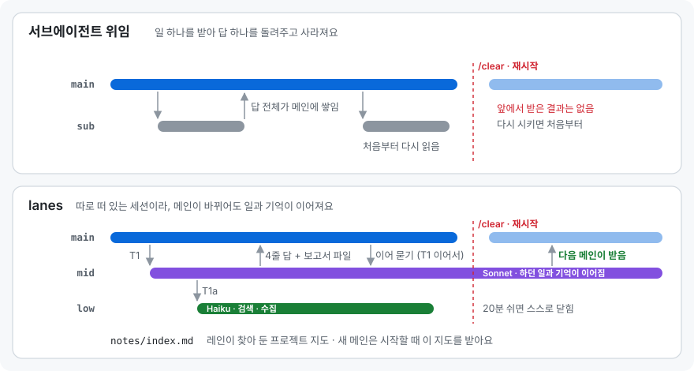

<div align="center">

# lanes

**메인 Claude Code 세션 옆에, 필요할 때만 켜지는 보조 세션 두 개.**<br>
아이디어 단계부터 출시까지, 판단이 필요한 보조 일은 Sonnet이, 기계적인 일은 Haiku가 맡고 메인(Opus) 문맥에는 결론만 쌓입니다.

[](lanes/.claude-plugin/plugin.json)
[](LICENSE)
[](https://code.claude.com)
[](#설치)
[](#bedrock--vertex--foundry)
[](https://github.com/jysvai/lanes)

**한국어** · [English](README.en.md) · [GitHub](https://github.com/jysvai/lanes) · [Issues](https://github.com/jysvai/lanes/issues) · [문의](#문의)

</div>

<p align="center"></p>

## 구조

<p align="center"></p>

레인은 **모델의 강점대로** 일을 나눠요.

| 세션 | 모델 (2순위) | effort | 맡는 일 |
|---|---|---|---|
| **main** | Opus 5.5 (Fable 5.1) | xhigh 이상 | **주 작업과 결정**: 코드·문서 작성, 커밋·배포. 레포를 고치는 건 메인뿐이에요 |
| **mid** 레인 | Sonnet 5.5 (Opus 5.5) | high 고정 | **판단이 필요한 보조 작업**: 조사·선택지 비교, 기획안·명세 초안, 리뷰, 테스트·검증 |
| **low** 레인 | Haiku 5.5 (Sonnet 5.5) | medium 고정 | **빠르고 기계적인 일**: 검색·목록, 자료 수집, 스크립트 실행·집계, 크롤링, 메모 정리 |

- 레인은 **일을 넘길 때 켜지고**, 20분 놀면 스스로 닫힙니다.
- 레인의 답장은 4줄 이내예요. 상세 보고는 `.claude/lanes/out/T<번호>.md`에 남습니다.
- 일하는 중인 레인에 일을 더 넘기면 대기열에 들어갔다가, 앞 작업이 끝나는 대로 넘어갑니다.
- 레인이 찾아 둔 위치·목록은 `.claude/lanes/notes/`에 쌓여서 같은 검색을 두 번 하지 않아요.
- 2순위 모델도 모두 5.x예요. **레인 모델로 Sonnet 4·Haiku 4는 쓰지 않아요**: 설정에 적어도 기본값으로 바뀌고, 쓸 수 있는 5.x가 없으면 옛 모델로 내려가는 대신 오류를 냅니다.

## 누구나, 어느 단계에서나

코드를 쓰기 전 아이디어·기획 단계에서도 똑같이 써요. 메인은 주 작업을 하고, 그 옆에서 레인이 보조 일과 추가 일을 받아 갑니다.

| 이런 분이라면 | main (Opus) | mid (Sonnet) | low (Haiku) | 이렇게 시작해 보세요 |
|---|---|---|---|---|
| **기획자** | 방향 결정, 최종 문서 | 시장·경쟁 조사, 선택지 비교, PRD·명세 초안, 기획 검토 | 레퍼런스·사례·수치 수집, 표로 정리 | `/lane 반려동물 산책 앱 아이디어, 비슷한 서비스와 차별점 정리해줘` |
| **개발자** | 코드 작성, 커밋·배포 | 변경 검증, 테스트, 리뷰, 원인 좁히기 | 코드 검색, 테스트·스크립트 실행, 로그 수집 | `/lane 로그인 버그 고치고 테스트까지 돌려줘` |
| **입문자·비전공자** | 쉬운 말로 한 단계씩 진행 | 대신 실행해 보고 되는지 쉬운 말로 확인 | 따라 하기 쉬운 가이드·예제 찾기, 설치 상태 점검 | `/lane 내 블로그를 인터넷에 올리고 싶어, 처음부터 같이 해줘` |

**단계마다 이렇게 나뉘어요**
- **아이디어**: mid가 비슷한 사례와 선택지를 조사·비교하고, low가 레퍼런스를 모아요. 메인은 같이 방향을 정해요.
- **기획**: mid가 명세·흐름 초안을 쓰고 빈틈을 검토해요. 메인이 최종본을 씁니다.
- **개발**: 메인이 만들고, mid가 검증·테스트하고, low가 검색·실행을 맡아요.
- **출시 전**: mid가 사용자처럼 끝까지 써 보며 점검하고, low가 체크리스트를 확인해요.

`/config`의 **How you work**(작업 방식)로 맞출 수 있어요. 기본값 `auto`는 메인이 대화를 보고 알아서 맞추고, `developer` · `planner` · `beginner`로 정해 두면 메인이 일을 나누는 방식과 레인이 보고하는 말투가 그쪽으로 고정돼요.

## 서브에이전트 위임과 다른 점

<p align="center"></p>

서브에이전트는 일을 받아 답 하나를 돌려주고 사라집니다. 레인은 **계속 살아 있는 세션**이라서 이런 일이 됩니다.

| | 서브에이전트 | lanes |
|---|---|---|
| 메인을 `/clear`·재시작·종료하면 | 결과도 같이 사라짐 | 레인은 하던 일을 끝내고, 답장은 **다음 메인 세션이 받아요** |
| 메인 문맥에 들어오는 것 | 서브에이전트의 최종 답 전체 | **4줄 답**과 보고서 파일 경로 |
| 같은 주제를 더 물을 때 | 처음부터 다시 읽음 | 레인이 기억하는 작업에 **이어서 물어요** (`in context: T5, T7`) |
| 찾아 둔 위치·구조 | 다음 호출엔 없음 | `notes/index.md`에 쌓이고, **메인은 세션을 시작할 때 이 지도를 받아요** |
| 비용 | 안 보임 | **작업마다** 든 비용과, Opus였다면 들었을 비용 (`/lane tasks`) |
| 단순 작업 다시 넘기기 | 메인을 거침 | mid가 low에 바로 넘김 |
| 레포 파일 수정 | 도구 권한대로 | `.claude/lanes/`와 임시 폴더 밖에는 **못 써요** (플러그인이 막음) |

- **받은 편지함**: 레인이 답장을 보낼 때 메인이 꺼져 있었거나 다시 시작됐으면, 그 답장은 다음 메인 세션의 프롬프트에 실립니다 (3일까지). 레인은 답장을 다시 보내려고 애쓰지 않아요.
- **이어 묻기**: `/lane status`에 레인이 아직 기억하는 작업이 나와요. 메인은 그 레인에 `(follow-up to T7) ...`로 보내서 설명을 반복하지 않습니다. 레인이 닫혔다 다시 열리면 이 목록은 비어요.
- **작업 장부**: `/lane tasks`

```
lane tasks in this project, newest first (2 of 2)
  T2    mid  open       3m    $0.01 (on main $0.20)  run the tests
  T1    low  DONE       1m    $0.01 (on main $0.20)  count the files
all 2 tasks: $0.02, on opus-5-5 $0.40. A sub-task (T7a) is counted on its own row.
```

## 같이 쓰면 더 좋아요

lanes는 혼자 쓸 때보다 **다른 절약 도구와 겹쳐 쓸 때** 효과가 커져요. 가진 게 있으면 그냥 같이 켜 두세요. 메인이 알아서 나눠 씁니다.

| 함께 쓰는 것 | 잘하는 일 | lanes와 함께면 |
|---|---|---|
| **토큰 절약 도구**: 직접 만든 것, Sprag(예전 이름 claude-token-saver) 같은 도구, Claude Code의 `/context`·`/cost` 같은 기본 기능 | 캐시·문맥·사용량을 지켜보고 낭비를 알려 줌 | 낭비가 보이는 일을 레인이 싼 모델로 덜어 가요 |
| **서브에이전트 · 위임 스킬 · 플러그인** | 한 번 묻고 끝나는 짧은 조회 | 짧은 건 서브에이전트, 길거나 이어지는 건 레인으로 |
| **lanes** | 길게 이어지는 보조 작업, 재시작해도 남아야 하는 일 | 메인 문맥은 결론만 받아 가벼워져요 |

메인은 "짧은 일회성 조회는 서브에이전트로, 길거나 이어지는 일은 레인으로, 사용자가 가진 절약·위임 스킬과 플러그인은 함께 쓰라"는 안내를 받고 시작해요.

## 얼마나 아끼나

<p align="center"></p>

웹 게임 프로젝트 하나를 오후 내내(4.6시간) 고친 실제 기록이에요. 같은 일을 **전부 Opus가 했을 때**와 비교했습니다.

| 기간 | 전부 Opus | lanes | 차이 |
|---|---:|---:|---:|
| 하루 (이 세션) | $106 | $71 | **−$35 (33%)** |
| 1주 · 5일 | $530 | $353 | **−$177** |
| 1달 · 21일 | $2,227 | $1,483 | **−$744** |
| 1년 · 250일 | $26,513 | $17,653 | **−$8,860** |

- **레인 몫만 보면 57%를 아꼈어요.** mid(Sonnet)는 $52.30 → $26.15로 절반, low(Haiku)는 $9.81 → $0.52로 95% 줄었습니다.
- **구독(Pro·Max)이라면** 요금은 그대로지만, 사용 한도도 대체로 모델 단가대로 깎여요. 같은 한도로 약 **1.5배** 일하는 셈입니다.
- **실제로는 더 아껴요.** 레인이 읽은 스크린샷·로그·검색 결과(이 세션에서 9천만 토큰 남짓)가 메인 대화에 쌓이지 않아서, 메인의 이후 모든 턴이 가벼워집니다. 이 몫은 표에 넣지 않았어요.
- **얻는 것은 비용만이 아니에요.** 메인 문맥이 가벼워 긴 작업에서도 덜 흐려지고, 검증·조사가 메인 작업과 동시에 돌아가며, 작업마다 결과와 비용이 장부에 남아요.
- **계산 방법:** 세션 기록에 남은 요청 하나하나의 토큰을 모델별 [API 정가](https://platform.claude.com/docs/en/about-claude/pricing)로 계산했습니다 (캐시 쓰기는 1시간 단가). 1주·1달·1년은 이 세션을 하루치로 잡고 곱한 값이에요.

내 프로젝트의 숫자는 `/lane usage`로 바로 볼 수 있어요:

```
lane spend today (2026-10-11), at API list prices
  main  opus-5-5         468 calls    $43.94
  mid   sonnet-5-5       767 calls    $26.15   on opus-5-5 $52.30  saved $26.15 (50%)
  low   haiku-5-5        147 calls     $0.52   on opus-5-5 $9.81  saved $9.29 (95%)
  lanes                  914 calls    $26.67   on opus-5-5 $62.11  saved $35.44 (57%)
  all                   1382 calls    $70.61   on opus-5-5 $106.05  saved $35.44 (33%)
```

표 아래에는 **어디서, 어떻게 아꼈는지**가 붙어요 (작업마다 장부가 있어서 가능해요):

```
where it came from, by task (most saved first)
  T1    mid  PARTIAL   $1.56 instead of   $3.11  saved  $1.55  Review the uncommitted changes under lanes/
  T2    low  DONE      $0.02 instead of   $0.78  saved  $0.76  Inventory, no edits: in README.md, docs/*.svg
how
  the same work on cheaper models: per token, sonnet-5-5 costs 1/2 of opus-5-5, haiku-5-5 costs 1/40–1/20 of opus-5-5
  and main's context stays light: the lanes took in 244k tokens (their prompts, and the files,
  logs and results they read) that main never read, nor carried through its later turns. That part is not in the table.
```

## 설치

Claude Code 2.1.296 이상에서 확인했어요 (더 낮으면 레인을 열 때 경고가 떠요). Windows · macOS · Linux 공통, Claude Code 프롬프트에서:

```
/plugin install lanes --marketplace jysvai/lanes
```

user 범위를 고르면 모든 프로젝트의 모든 세션에서 켜집니다. 터미널에서 설치할 때는 이렇게 합니다:

```
claude plugin marketplace add jysvai/lanes
claude plugin install lanes@claude-mod --scope user
```

"설정값을 아직 정하지 않았다"는 안내가 떠도 아래 기본값으로 동작해요.

## Bedrock · Vertex · Foundry

Claude Code가 Amazon Bedrock, Google Vertex AI, Microsoft Foundry로 설정돼 있으면 (`CLAUDE_CODE_USE_BEDROCK=1` 등, `settings.json`의 `env`에 둔 것도 돼요) 레인 모델을 **그쪽에서 쓰는 이름으로 바꿔서** 띄워요. 설정에는 Claude API 이름(`claude-sonnet-5-5`)을 그대로 두면 됩니다.

| 제공자 | mid 레인이 쓰는 이름 (기본값일 때) |
|---|---|
| Claude API | `claude-sonnet-5-5` |
| Amazon Bedrock | `us.anthropic.claude-sonnet-5-5`: 리전이 `us-*`면 `us.`, `us-gov-*`면 `us-gov.`, `eu-*`면 `eu.`, 그 밖이거나 리전을 안 정했으면 `global.` (`ANTHROPIC_BEDROCK_REGION_PREFIX`로 직접 지정) |
| Bedrock Mantle | `anthropic.claude-sonnet-5-5` (계정에 Mantle 권한이 있어야 해요. `CLAUDE_CODE_USE_BEDROCK`과 함께 켜져 있으면 Mantle 이름을 써요) |
| Vertex AI | `claude-sonnet-5-5` (Vertex의 정확한 ID는 아직 확인하지 못했어요. 아래처럼 고정해 두면 확실해요) |
| Foundry | 배포 이름: 아래처럼 고정한 값, 없으면 `claude-sonnet-5-5` |

- **고정해 둔 모델이 먼저예요.** `ANTHROPIC_DEFAULT_SONNET_MODEL` · `_HAIKU_` · `_OPUS_` · `_FABLE_`에 모델을 고정해 뒀으면(애플리케이션 추론 프로필 ARN 포함) 그것을 씁니다. 단, 4.x Sonnet·Haiku를 가리키면 레인 모델로는 건너뛰어요 (Claude Code가 자체 배경 작업에 쓰는 모델까지 바꾸지는 않아요).
- **직접 적으면 그대로.** `/config`에 `eu.anthropic.claude-sonnet-5-5`나 ARN처럼 제공자 형식을 적으면 바꾸지 않아요.
- **모델 ID 출처:** AWS Bedrock 모델 카드 (2026-10 기준). Opus 5.5 · Sonnet 5.5 · Haiku 5.5는 `us.` · `eu.` · `global.` 프로필이 있고, Fable 5.1은 `us.` · `global.`만 있어요.
- **메인 실행 스크립트**(`claude-main`)는 Claude API 이름을 그대로 넘기고, Claude Code가 제공자 이름으로 바꿔요.
- **비용:** Bedrock `global.` 프로필은 정가와 같고, 리전 프로필은 10% 비싸요. `/lane usage`는 정가로 계산해요 (레인과 메인이 같은 비율로 움직여 절약 비율은 같아요).
- **macOS 창 모드:** 새 Terminal 창에 제공자·리전·프로필·게이트웨이 주소 설정을 넘겨요. 키(AWS 키·토큰)는 파일에 쓰지 않아서, Terminal이 이미 열려 있으면 새 창에 키가 없을 수 있어요. 키는 `settings.json`의 `env`나 AWS 프로필에 두거나, 레인을 background로 띄우세요.
- **확인 범위:** 이름 바꾸기는 테스트로 확인했어요. 실제 Bedrock·Vertex 계정에서 레인을 띄워 본 건 아니에요.

## 쓰는 법

```
/lane <하고 싶은 일>          메인이 나눠서 끝까지 진행
/lane status                  레인 상태 · 이어 물을 수 있는 작업 · 최근 보고서 · 오늘 레인 비용
/lane tasks                   작업 장부: 결과 · 걸린 시간 · 작업마다 든 비용
/lane usage [all]             오늘(all: 기록 전체) 쓴 금액과 Opus 대비 절약액
/lane mid <할 일>             mid 레인에 바로 넘기기 (low도 같음)
/lane start | stop [mid|low]  미리 켜기 · 닫기
/lane help                    명령 목록
```

한글로도 돼요: `/lane 상태` · `/lane 작업` · `/lane 비용 [전체|오늘]` · `/lane 시작|중지 [mid|low|전체]` · `/lane 도움말`. 대소문자는 가리지 않고, `/lane usage weekly`처럼 인자를 잘못 쓰거나 `/lane statsu`처럼 오타를 내면 메인에게 일을 넘기는 대신 사용법을 보여 줘요.

`/lane 로그인 버그 고쳐줘`처럼 적으면 메인이 일을 나눠 레인에 넘깁니다. 그동안 자기는 주 작업을 하고, 레인의 결과를 받아 반영하고, 고친 것은 mid에 다시 확인시킨 뒤 바뀐 것과 확인한 것을 보고합니다. 코드가 없는 일(`/lane 이 기획안 빈틈 찾아줘`)도 같은 방식이에요.

### 상태줄 읽는 법

```
lanes  sonnet ● T3 2m +1 · haiku ○
```

| 표시 | 뜻 |
|---|---|
| `●` `○` `off` | 작업 중 · 대기 · 꺼짐 |
| `T3` | 이 프로젝트에서 레인에 넘긴 **3번째 작업**이에요. 터미널 번호가 아닙니다. 보고서도 같은 번호로 남아요 (`out/T3.md`). |
| `2m` | 그 작업을 시작한 지 2분 |
| `+1` | 뒤에서 기다리는 작업 1개 |

## 설정 `/config`

| 항목 | 기본값 |
|---|---|
| main 모델 · 2순위 · 최소 effort | `claude-opus-5-5[1m]` · `claude-fable-5-1` · `xhigh` |
| mid 모델 · 2순위 · effort | `claude-sonnet-5-5` · `claude-opus-5-5` · `high` |
| low 모델 · 2순위 · effort | `claude-haiku-5-5` · `claude-sonnet-5-5` · `medium` |
| 작업 방식 (How you work) | `auto` · `developer` · `planner` · `beginner` |
| 레인 여는 방식 | `window` (새 창) · `background` (`claude attach <이름>`으로 보기) |
| 레인 권한 모드 | `auto` · `acceptEdits` · `dontAsk` · `manual` · `bypassPermissions` |
| 놀면 닫기 | `20`분 (0이면 안 닫음) |

<details>
<summary><b>더 보기</b>: effort 규칙 · 프로젝트별 지시 · 주의할 점 · 개발</summary>

**effort 규칙**
- 메인이 Opus·Fable이면 effort가 최소값 아래로 내려가지 않아요.
- 레인 effort는 고정이라 `/effort`로 바꿔도 설정값으로 돌아갑니다.
- 메인의 2순위 모델은 실행할 때만 정할 수 있어서 실행 스크립트를 넣어 뒀어요: `lanes/bin/claude-main.ps1` (Windows), `lanes/bin/claude-main.sh` (macOS).

**프로젝트별 지시**
- 프로젝트에 `.claude/lanes/roles/mid.md`, `low.md`를 두면 레인 역할 프롬프트 끝에 붙습니다. 그 프로젝트의 테스트 명령, 검증 방법, 기획 문서 위치 같은 것을 적는 곳이에요.
- 작업 방식별 안내는 `lanes/roles/styles/`에 있어요 (`developer.md` · `planner.md` · `beginner.md`).
- `.claude/lanes/` 폴더는 첫 실행 때 자기 `.gitignore`를 만들어서 git에 올라가지 않아요.

**주의할 점**
- 레인 이름은 `<폴더 이름>-<경로 태그>-mid` 꼴이에요 (예: `claude-mod-8071-mid`). 이름이 같은 폴더나 한글 이름 폴더끼리도 레인이 섞이지 않아요. 이전 버전에서 켠 `claude-mod-mid` 같은 레인은 놀다가 스스로 닫힙니다.
- 회사 PC처럼 실행 정책이 `.ps1` 파일을 모두 막아도 돼요. 플러그인은 스크립트를 파일이 아니라 스크립트 블록으로 실행하고, claude도 npm의 `claude.ps1` 대신 `claude.exe`나 `claude.cmd`로 띄웁니다. 다만 AppLocker·WDAC의 제한 언어 모드(Constrained Language Mode) PC에서는 동작하지 않아요.
- macOS에서는 레인 창을 `open -a Terminal`로 열어서 "다른 앱 제어" 권한을 묻지 않아요. 새 창은 지금 세션의 PATH와 `CLAUDE_CONFIG_DIR`을 이어받습니다.
- 레인이 막혀 있는 것: Edit, 레포 안에서 `.claude/lanes/` 밖에 Write, git의 commit · push · reset · checkout · restore · stash · clean · switch · rebase · merge · cherry-pick · revert · apply · am · rm · mv. Bash로 파일을 바꾸는 것(`sed -i` 등)까지는 막지 못하니, 권한 모드를 `bypassPermissions`로 둘 때는 이 점을 감안하세요.
- auto 모드를 못 쓰는 계정이면 `/config`에서 레인 권한 모드를 바꾸세요. background 레인은 권한을 물어도 답할 사람이 없어서, `dontAsk`(허용 목록을 미리 설정)나 `manual` + window를 권해요.
- Claude의 도구 호출(Bash 등) 안에서 레인을 띄우면 메시지를 받지 못합니다. "자식 세션" 표시를 물려받기 때문이에요. `/lane`과 `send`는 세션 본체에서 띄우니 괜찮습니다. 손으로 띄울 때는 직접 연 터미널에서 띄우세요:
  - Windows: `powershell -ExecutionPolicy Bypass -File lanes\bin\lanes.ps1 start -Project <프로젝트 폴더>`
  - macOS·Linux: `LANES_PROJECT=<프로젝트 폴더> bash lanes/bin/lanes.sh start`
- `settings.json`에 `CLAUDE_CODE_SUBAGENT_MODEL_FORCE`가 있으면 서브에이전트가 모두 그 모델로 강제됩니다. 그래서 레인은 서브에이전트 대신 low 레인에 일을 넘기도록 되어 있어요.
- Linux에서는 창 대신 background로 띄웁니다. 볼 때는 `claude attach <레인 이름>`을 쓰세요 (이름은 `/lane status`에 나와요).

**로컬 폴더에서 설치 · 개발**
```
/plugin marketplace add <이 저장소를 받은 폴더>
/plugin install lanes@claude-mod

claude plugin validate lanes
claude plugin test lanes
```
</details>

## 문의

질문, 버그 제보, 제안은 [GitHub Issues](https://github.com/jysvai/lanes/issues)에 남기거나 이메일 **yunseok1312@gmail.com** 으로 보내 주세요. 보안 문제는 Issues 대신 이메일로 알려 주세요 ([SECURITY.md](SECURITY.md)).

## 라이선스

[Apache License 2.0](LICENSE) · Copyright 2026 jysvai
