<div align="center">

# What lanes actually saves

**Measured on four projects, on one day and on thirteen days (three stretches) across several, and the same tasks run on three models**

[한국어](dollar-savings.md) · **English** · [Back to the README](../README.en.md)

</div>

<p align="center"></p>

## At a glance

| | Project 1 · a web game | Project 2 · the lanes plugin | Project 3 · a work planning doc (Bedrock) | Project 4 · a Python web service | All four |
|---|---:|---:|---:|---:|---:|
| Session (KST) | Oct 11, 14:07–18:48 | Oct 11, 21:10 – Oct 12, 00:33 | Oct 12, 12:03–12:56 | Oct 12, 11:43–16:51 | |
| Length | 4.7 h | 3.4 h | 0.9 h | 5.1 h | 14.1 h |
| Lane tasks | 29 | 7 | 3 | 2 | 41 |
| All on Opus | $106.13 | $39.51 | $6.92 | $49.50 | $202.06 |
| With lanes | $70.64 | $30.89 | $4.58 | $47.63 | $153.74 |
| **Saved** | **−$35.48 (33%)** | **−$8.62 (22%)** | **−$2.34 (34%)** | **−$1.87 (4%)** | **−$48.32 (24%)** |
| The lanes' share alone | 57% saved | 66% saved | 63% saved | 50% saved | |
| Work the same money buys | 1.50× | 1.28× | 1.51× | 1.04× | 1.31× |
| Tokens kept out of main's context | 109.1M | 12.0M | 1.9M | 3.8M | 126.7M |
| Saved in main's context (estimate) | ≈$12.23 | ≈$7.77 | ≈$0.03 | ≈$2.39 | |
| With that counted | ≈40% | ≈35% | ≈34% | ≈8% | |

- **"All on Opus"** prices the tokens the lanes used at Opus 5.5 rates. What main spent is the same on both sides.
- **Why the projects differ:** on the game, the lanes ran long playtests and regression runs (mid: 213 minutes). On the plugin, main spent most of the time changing the code itself and gave the lanes seven reviews and lookups. The planning session was short, so main's share was large, but the low lane did the web research at 3% of Opus's price, so the lanes' share saved 63%. On the web service, main did nearly all the work itself (2 lane tasks). **The more side work goes to the lanes, the more they save.**
- **Saved in main's context (estimate)** is what main's later requests would have read again had main read the lanes' material itself. It is an estimate, not a measurement, so it isn't in the saving. How it's worked out is [below](#saved-in-mains-context-estimate).
- **A whole day looks much the same.** Over Oct 14, four projects (one of them project 1's web game) went from $197.79 to $152.73, 23% saved. It's [below](#one-working-day-oct-14).
- **So do four days.** Over Oct 15–18, five projects went from $724.55 to $601.64, 17% saved (56% on the lanes' share alone): 23% on the web game, which handed off the most, and 9–12% on the other four. It's [below](#four-days-of-real-use-oct-1518).
- **Hand work to Opus subagents and the saving shrinks.** Over the next stretch, Oct 18 evening to Oct 23, six projects went from $1,928.91 to $1,804.92, only 6% saved: over half the spend (≈$977.53) was subagents main started with the Agent tool on one project, all but two of them on Opus. From 0.3.12 `/lane usage` shows that share on its own line. It's [below](#five-more-days-oct-18-evening-to-oct-23).
- **Hand off more and it climbs back.** Over Oct 24–27, seven projects went from $1,432.64 to $1,118.64, 22% saved. The lanes took 229 tasks in four days, over three times the 75 of the five days before, and main ran 34 lookups and commands itself per lane task, down from 82. The thirteen days of Oct 15–27 together went from $4,086.10 to $3,525.20, 14%. It's [below](#four-more-days-oct-2427).
- **On a subscription (Pro, Max)** the bill doesn't change, but usage limits are drawn down by model price too, so the same limit stretches about 1.3× further.

## Project 1 · a web game

An afternoon of fixing a browser game, reworking its translations and playing it on a phone to check.

<p align="center"></p>

| Session | Model | Calls | Cost | On Opus |
|---|---|---:|---:|---:|
| main | Opus 5.5 | 468 | $43.94 | $43.94 |
| mid lane | Sonnet 5.5 | 769 | $26.19 | $52.37 |
| low lane | Haiku 5.5 | 147 | $0.52 | $9.81 |
| **Total** | | 1,384 | **$70.64** | **$106.13** |

- **What the lanes did:** 29 tasks, among them triaging 46 search hits, full regression runs, a sweep of all 16 cases, checks of the translation packs, regression runs after the translation edits, and checking fixes and tracking down causes.
- **Time at work:** main 154 minutes, mid 213, low 52. Of the lanes' 265 minutes, 115 ran while main was at work too.
- **What the lanes read:** 109.1M tokens of screenshots, logs and search results that never piled up in main's conversation. That part is not in the savings.

## Project 2 · the lanes plugin (this repo)

A night session building lanes 0.3.0, fixing what the security review found, and making this page, counted up to 00:33, when this page was started.

<p align="center"></p>

| Session | Model | Calls | Cost | On Opus |
|---|---|---:|---:|---:|
| main | Opus 5.5 | 266 | $26.13 | $26.13 |
| main's subagents | Haiku 5.5 | 8 | $0.30 | (as is) |
| mid lane | Sonnet 5.5 | 81 | $4.07 | $8.13 |
| low lane | Haiku 5.5 | 41 | $0.40 | $4.96 |
| **Total** | | 396 | **$30.89** | **$39.51** |

Each lane task (the `/lane tasks` ledger):

| Task | Lane | Result | Took | Cost | On Opus | What |
|---|---|---|---:|---:|---:|---|
| T3 | low | DONE | <1 min | $0.01 | $0.37 | Check after a restart |
| T4 | mid | PASS | 3 min | $0.37 | $0.73 | Install from GitHub on a clean setup |
| T5 | low | BLOCKED | 4 min | $0.28 | $2.53 | Collect Bedrock and Vertex model IDs (Bedrock confirmed only) |
| T6 | mid | PASS | 5 min | $0.63 | $1.26 | Check the prices against the official page |
| T7 | mid | PARTIAL | 7 min | $1.27 | $2.53 | Review all of 0.3.0: **two real bugs** found |
| T8 | mid | PARTIAL | 21 min | $1.80 | $3.61 | Security review: **ten issues to fix** found |
| T9 | low | PARTIAL | 19 min | $0.10 | $2.06 | Find the evidence behind project 1's figures |
| | | | **60 min** | **$4.46** | **$13.09** | |

- **Not just money.** The bugs T7 found (a model given as an ARN kept lanes from opening on macOS and Linux; the GovCloud region prefix) are fixed in this version. So are the ten issues T8 found; after the fixes, the mid lane reviewed them again (T10) and the gaps it still found were closed too. A lane instructions file a repo ships stays as trusted as its `CLAUDE.md`, which the README lists as a limit.
- **Time at work:** main 151 minutes, mid 36, low 25. Nearly all the lanes' work ran while main was at work.

## Project 3 · a work planning doc (through a gateway to Bedrock)

A lunchtime session on a work Mac, through the company's LLM gateway to Amazon Bedrock, writing the planning doc for an internal tool. Anything that would name the company or the project (names, paths, account numbers) is left out.

<p align="center"></p>

| Session | Model | Calls | Cost | On Opus |
|---|---|---:|---:|---:|
| main | Opus 5.5 (7 on Sonnet 5.5) | 20 | $3.21 | (the same) |
| mid lane | Sonnet 5.5 | 19 | $1.34 | $2.67 |
| low lane | Haiku 5.5 | 11 | $0.03 | $1.04 |
| **Total** | | 50 | **$4.58** | **$6.92** |

Each lane task (the `/lane usage` ledger; a task's cost is its share of the day's lane cost by its number of requests, an estimate marked `≈`):

| Task | Lane | Result | Took | Cost | On Opus | What |
|---|---|---|---:|---:|---:|---|
| T1 | low | DONE | 3 min | ≈$0.03 | ≈$1.04 | Collect and sort the evidence for the doc from the web |
| T2 | mid | DONE | 3 min | ≈$0.56 | ≈$1.12 | Write the doc's policy, risks, success measures and rollout |
| T3 | mid | DONE | 10 min | ≈$0.77 | ≈$1.55 | Following up T2, put the finished doc together |
| | | | **16 min** | **$1.36** | **$3.71** | |

- **It saves just the same at work.** This gateway answers with a Bedrock application inference profile's ARN where the model name would be, so up to 0.3.1 `/lane usage` showed $0. From 0.3.2 a request is priced by the model it asked for, and from 0.3.3 a day logged at $0 before that is priced again from its token totals.
- **Research saves the most on the low lane.** The web research (T1) cost 3% of what it would have on Opus, and Sonnet wrote the doc (T2, T3) at half the price. The lanes work the same on a job with no code in it.
- **Time at work:** main 14 minutes, mid 13, low 3. Of the lanes' 15 minutes, 6 ran while main was at work too.
- **A short session leaves main a large share.** Main spent 70% of it ($3.21), so though the lanes' share saved 63%, the session as a whole saved 34%. Main was switched to Sonnet for 7 of its requests during the session; those are priced as the model they ran on.

## Project 4 · a Python web service

A daytime session on a personal computer, building a Python web service and refining it by opening it in the browser. Names and paths that would identify the service are left out.

<p align="center"></p>

| Session | Model | Calls | Cost | On Opus |
|---|---|---:|---:|---:|
| main | Opus 5.5 | 427 | $45.75 | $45.75 |
| mid lane | Sonnet 5.5 | 37 | $1.87 | $3.75 |
| low lane | Haiku 5.5 | 0 | $0.00 | $0.00 |
| **Total** | | 464 | **$47.63** | **$49.50** |

Each lane task (the `/lane usage` ledger):

| Task | Lane | Result | Took | Cost | On Opus | What it did |
|---|---|---|---:|---:|---:|---|
| T1 | mid | DONE | 6 min | $1.11 | $2.22 | Found and wrote up the outside API keys the service needs and how to get them |
| T2 | mid | PARTIAL | 5 min | $0.77 | $1.53 | Code review (comments only, no edits) |
| | | | **11 min** | **$1.88** | **$3.75** | |

- **Hand off less, save less.** Main did nearly everything here itself: 134 lookups, 196 other commands, 84 browser steps and 68 file writes and edits, against 2 tasks for the lanes. The lanes' share saved 50%, the session as a whole 4%.
- **Half of main's cost was reading again.** Of main's $45.75, $23.92 (52%) went on reading the conversation so far from the cache at each request. The conversation grew to 470k tokens and was compacted twice. The lookup and command output main read itself came to about 160k tokens (480k characters).
- **0.3.7 came out of this session.** Once main has read over 40k tokens of lookups and command output itself since its last hand-off, the next tool result carries a short note, for main only, that such work can go to a lane. `/lane usage` now shows what main did itself, and what was saved in main's context (below).
- **Time at work:** main 142 minutes, mid 11, low 0. All 11 of the lanes' minutes ran while main was working too.

## One working day: Oct 14

Each project above is one session. This time it's a whole day: the four projects worked on with the lanes on this PC on Oct 14, gathered from what `/lane usage` showed in each that day and checked against the session logs. One is project 1's web game (its fourth day); the other three are new. Names and paths that would identify the projects are left out.

<p align="center"></p>

| | Blog automation | A Node CLI tool | An OCR model | The web game (project 1) | All four |
|---|---:|---:|---:|---:|---:|
| main (Opus 5.5) | $29.29 · 344 | $29.14 · 335 | $27.52 · 287 | $23.87 · 323 | $109.82 |
| mid lane (Sonnet 5.5) | $2.42 · 56 | $1.59 · 38 | $4.97 · 84 | $33.77 · 1,360 | $42.75 |
| low lane (Haiku 5.5) | — | $0.16 · 54 | — | — | $0.16 |
| All on Opus | $34.14 | $34.78 | $37.46 | $91.41 | $197.79 |
| With lanes | $31.71 | $30.89 | $32.49 | $57.64 | $152.73 |
| **Saved** | **−$2.42 (7%)** | **−$3.89 (11%)** | **−$4.97 (13%)** | **−$33.77 (37%)** | **−$45.05 (23%)** |
| Lane tasks | 3 | 4 | 4 | 8 | 19 |
| Time at work, main / lanes | 99 / 15 min | 113 / 12 min | 87 / 29 min | 70 / 519 min | |
| Lookups and commands main ran itself | 305 | 320 | 228 | 292 | |
| Saved in main's context (estimate) | ≈$2.58 | ≈$5.38 | ≈$3.81 | ≈$0.00 | ≈$11.77 |
| Together with that | ≈14% | ≈23% | ≈21% | ≈37% | ≈27% |

(The figures after a cost are requests.)

- **Again, the more handed off, the more saved.** On the web game, while main worked 70 minutes, the mid lane ran browser playtests for over eight hours (T81–T88, 100–300 requests a playtest). The lanes spent more than main, and 75% of the day's saving came from there. On the other three, main worked 87–113 minutes itself and the lanes 12–29, for 7–13%.
- **A big saving can come with a big bill.** The web game saved the most and also cost the most ($57.64): it ran the same kind of playtest seven times. "Saved" is the gap to the same work on Opus; it doesn't say whether the work was needed.
- **The low lane is the cheapest.** On the Node CLI tool, the low lane ran and summed up the full checks twice for $0.16 ($2.45 on Opus, 6%). The other three projects didn't use the low lane that day.
- **Main still did a lot itself.** 0.3.8 (main decides what goes to a lane before it starts) was on that day, yet on the three projects other than the game main ran 228–320 lookups and commands itself, against 3–4 lane tasks.
- **Checked:** on blog automation, the Node CLI tool and the OCR model, `/lane usage` and the session logs agree on every request count, and on cost to within 0.1%. On the web game the lane was still playtesting while this was measured, so the two couldn't be cut at exactly the same moment. The table is from when `/lane usage` was read (mid 1,360 requests, $33.77); the session logs a few minutes later had 1,372 requests and $34.00, the difference being what ran in between. The lanes' 519 minutes include those few minutes too. Main has the same request count; its cost differs by 0.6%, from how 8 subagent requests were logged. Like `/lane usage`, the day is a calendar day, so the tail of a session that ran past midnight counts toward it.
- **Saved in main's context is counted the fixed way (0.3.9).** That day `/lane usage` still counted it the old way and showed ≈$2.60, ≈$4.27, ≈$1.83 and ≈$0.26. The table works it out again from the session logs, up to the moment `/lane usage` was run in each project. On the web game the lane read 100k–370k tokens a task; with the fill size taken from where main was compacted that day, had main read that itself, its conversation would have filled at once and been compacted, so it counts as 0 ([below](#saved-in-mains-context-estimate)).
- **Checking the figures found a bug.** On the web game, `/lane usage`'s "all" row saved $0.44 more ($34.21) than its lanes row ($33.77). That was main's own code-review subagent (Sonnet 5.5, 8 requests): its saving didn't show on main's row and was counted as the lanes' in "the lanes saved". From 0.3.9 it shows on main's row and stays out of the lanes' saving. The table above counts main's subagents at what they cost too, as for project 2. The same day's figures also showed two gaps in the main's-context estimate, now fixed (below).

## Four days of real use: Oct 15–18

A longer stretch as well: the five projects worked on with the lanes on this PC from Oct 15, midnight, to Oct 18, 5 pm. The web game (project 1), the OCR model and blog automation were there on Oct 14 too; two are new. The figures are what the lanes logged per day in each project (what `/lane usage` shows), checked against the session logs. This repo's sessions, where the lanes plugin itself was being fixed, are left out.

<p align="center"></p>

| | Blog automation | A CI dashboard | An OCR model | An event-page collector | The web game (project 1) | All five |
|---|---:|---:|---:|---:|---:|---:|
| main (Opus 5.5) | $39.01 · 498 | $50.18 · 404 | $77.97 · 946 | $116.26 · 1,173 | $222.26 · 2,223 | $505.68 |
| Of it, main's subagents (estimate) | — | — | — | — | ≈$114.99 | ≈$114.99 |
| mid lane (Sonnet 5.5) | $2.08 · 54 | $4.61 · 132 | $6.84 · 89 | $6.66 · 151 | $74.20 · 2,987 | $94.40 |
| low lane (Haiku 5.5) | $0.09 · 32 | $0.06 · 28 | $0.14 · 4 | $0.56 · 136 | $0.71 · 153 | $1.56 |
| All on Opus | $46.15 | $61.00 | $93.27 | $139.67 | $384.46 | $724.55 |
| With lanes | $41.18 | $54.85 | $84.94 | $123.49 | $297.18 | $601.64 |
| **Saved** | **−$4.97 (11%)** | **−$6.15 (10%)** | **−$8.33 (9%)** | **−$16.18 (12%)** | **−$87.28 (23%)** | **−$122.91 (17%)** |
| On the lanes' share alone | 70% | 57% | 54% | 65% | 54% | 56% |
| Lane tasks | 5 | 5 | 7 | 14 | 28 | 59 |
| Time at work, main / lanes | 144 / 21 min | 171 / 42 min | 272 / 27 min | 392 / 103 min | 407 / 758 min | 1,386 / 951 min |
| Lookups and commands main ran itself | 414 | 356 | 823 | 1,094 | 1,180 | 3,867 |
| Saved in main's context (estimate) | ≈$1.28 | ≈$2.19 | ≈$0.24 | ≈$4.11 | ≈$13.45 | ≈$21.27 |
| Together with that | ≈14% | ≈14% | ≈9% | ≈15% | ≈26% | ≈20% |

(The figures after a cost are requests.)

- **71% of the saving came from the web game,** $70.48 of it on the 18th alone. That day the mid lane played the game as a first-time player in several languages, one to two hours a run: work worth $124.38 on Opus, done for $62.19 (2,533 requests). Days without the lanes (the web game on the 15th and 16th, the OCR model on the 18th) saved nothing.
- **Most of the money is main's own.** Of the $601.64 spent, $505.68 (84%) was main. Main ran 3,867 lookups and commands and made 762 edits itself, against 59 lane tasks: about 65 lookups and commands of main's per lane task. The four projects that handed off less saved 9–12%, as on Oct 14.
- **Main's subagents ran on Opus.** On the web game, the 15 subagents main started (866 requests) ran on main's model, Opus, for about $115 (main's $222.26 less the $107.27 in main's own log, an estimate): about 1.5 times what the whole mid lane cost ($74.20). The event-page collector ran its subagents on Sonnet and saved $2.55 (the table's main is what it cost; that share is in "All on Opus"). Long-running work is cheaper handed to a lane than to a subagent.
- **Saved in main's context is largest on the web game (≈$13.45),** mostly from small low-lane tasks. A mid playtest read 120k–560k tokens at once, more than the room left in main, so it counts as 0, as on Oct 14 ([below](#saved-in-mains-context-estimate)).
- **Subagents' cache writes are priced again at the 5-minute rate.** Main and the lanes write the 1-hour cache, but subagents write the 5-minute one (the session logs say which, request by request). The lanes then priced every write at the 1-hour rate, which put the web game's main $28.79 too high; the table takes that off. The saving is the same; only the share moves, from 16% to 17%. From 0.3.12 the lanes price it at the 5-minute rate too.
- **Checked:** for the lanes, and for main outside the web game, the lanes' logs and the session logs agree on request counts and cost. Only the web game's main shows fewer output tokens in the session logs, with requests and input and cache tokens the same: 587 of its subagents' requests have no final usage in their logs. So the table uses what the lanes counted request by request. The event-page collector's main differs by 0.4% for the same reason. The 18th is counted until 5 pm, and a session started before midnight on the 15th from that moment.
- **0.3.11 came out of these four days.** Going through the lanes' task logs found a task lost to a lane that was closing, five tasks left "open" for days after a stop or a lane closing mid-task, and `/lane status` showing no progress through an hour-long playtest; all three are fixed.

## Five more days: Oct 18 evening to Oct 23

Then from Oct 18, 5 pm, to Oct 24, midnight: the six projects worked on with the lanes on this PC. Blog automation, the event-page collector and the OCR model were there in the four days before; three are new. The web game rested. Counted the same way as the four days.

<p align="center"></p>

| | Regulation research | Work automation | An event-page collector | An OCR model | Blog automation | A 3D web service | All six |
|---|---:|---:|---:|---:|---:|---:|---:|
| main (Opus 5.5) | $5.12 · 66 | $36.60 · 323 | $69.52 · 712 | $57.47 · 617 | $184.02 · 1,908 | $1,344.21 · 13,435 | $1,696.94 |
| Of it, main's subagents (estimate) | — | — | — | — | — | ≈$977.53 | ≈$977.53 |
| mid lane (Sonnet 5.5) | $1.53 · 39 | $5.64 · 102 | $3.16 · 57 | $8.24 · 89 | $8.17 · 170 | $80.04 · 1,994 | $106.78 |
| low lane (Haiku 5.5) | — | — | — | $0.83 · 10 | — | $0.38 · 61 | $1.20 |
| All on Opus | $8.18 | $47.88 | $75.83 | $80.49 | $200.37 | $1,516.16 | $1,928.91 |
| With lanes | $6.65 | $42.24 | $72.67 | $66.54 | $192.19 | $1,424.63 | $1,804.92 |
| **Saved** | **−$1.53 (19%)** | **−$5.64 (12%)** | **−$3.16 (4%)** | **−$13.95 (17%)** | **−$8.18 (4%)** | **−$91.53 (6%)** | **−$123.99 (6%)** |
| On the lanes' share alone | 50% | 50% | 50% | 61% | 50% | 52% | 52% |
| Lane tasks | 1 | 6 | 3 | 6 | 9 | 50 | 75 |
| Time at work, main / lanes | 22 / 9 min | 183 / 61 min | 345 / 22 min | 183 / 32 min | 755 / 67 min | 1,406 / 804 min | 2,894 / 995 min |
| Lookups and commands main ran itself | 51 | 268 | 631 | 524 | 1,458 | 3,218 | 6,150 |
| Saved in main's context (estimate) | ≈$0.00 | ≈$0.36 | ≈$1.79 | ≈$0.47 | ≈$7.41 | ≈$15.54 | ≈$25.57 |
| Together with that | ≈19% | ≈13% | ≈7% | ≈18% | ≈8% | ≈7% | ≈8% |

- **The saving fell to 6%.** Of the $1,804.92 spent, $1,424.63 (79%) was the 3D web service, and ≈$977.53 of that was subagents main started with the Agent tool. Ten of the twelve ran on main's model, Opus: one building a 3D scene made 5,316 requests over three days, then ones building characters, staging scenes, fixing security findings, and four researching a timeline. Only two reviewers (83 requests) ran on Sonnet. The lanes did 6% of what that project spent. Leave it out and the same stretch went from $412.75 to $380.29, 8%.
- **A subagent's cache lasts 5 minutes.** Main's and the lanes' cache lasts an hour; a subagent's is gone after 5 idle minutes. On the 3D web service, after 10 to 60 idle minutes main and the lanes wrote their cache again on 0 of 82 requests, the subagents on 11 of 15 (73%); after 5 to 10 minutes the subagents still did on 46%. Waiting on a build or a render, a subagent writes its whole 300k–400k-token context again: 25 such writes of over 100k tokens after 5 to 60 idle minutes came to ≈$40.
- **The lanes saved as much as ever.** On the lanes' share alone it is 52%, close to the four days before (56%), and the day the lanes took the most (the 23rd, 21 tasks) saved 18%. What fell is the share the lanes took: main ran 6,150 lookups and commands itself, against 75 lane tasks.
- **Building isn't lane work.** The lanes don't change files, so the subagents that built the 3D scene or the characters had work no lane could take. There the fix is giving the subagent a model that fits the work (on Sonnet, half the price). Research and write-ups, like the timeline, can go to a lane.
- **What 0.3.12 changes:** `/lane usage` shows main's subagents on a line of their own (requests, cost, and the part on main's model), and when over a dollar of it ran on main's model, adds that their 5-minute cache makes a long wait write their context again and that long side work is cheaper in the mid lane (1/2 per token). Main's instructions now say that a subagent runs on main's model unless given another and keeps its cache for 5 minutes, so one that writes or builds gets the model the work needs, and long side work goes to a lane. Subagents' cache writes are priced at the 5-minute rate (1.25× input). Before, the 1-hour rate put the 3D web service's main $116.70 too high over this stretch; the table takes that off.
- **No task was lost from a lane ledger.** Of the 75 lane tasks, 5 ended STOPPED ($3.61), three of them the same measurement run while the user was playing a game. Regulation research's T3 stays "open" because its lane session ended mid-task; it closes as STOPPED when that lane next opens (0.3.11). One task sent at 17:46 on the 18th (this repo's T27), from sessions opened before 0.3.11 was written, went to a lane held at its exit prompt and was lost: the very case 0.3.11 fixes.
- **Checked:** only the 3D web service's main comes out lower from the session logs. Requests and input and cache tokens agree, but 7,338 of its subagents' 9,753 requests have no final usage in their logs, so their output tokens go missing; the table uses what the lanes counted request by request. The other five projects and the lanes agree on requests and cost. `session-stats.mjs` is fixed this time: it reads a log too big for one string in pieces, prices subagents' cache writes at the 5-minute rate, and counts a subagent's requests after its main session ended (71 here).

## Four more days: Oct 24–27

From the day 0.3.12 came out to Oct 28, midnight: the seven projects worked on with the lanes on this PC. The web game was back; the 3D web service, blog automation and work automation were there in the five days before; three are new. Counted the same way.

<p align="center"></p>

| | A local coding-agent CLI | An Excel converter | Blog automation | A trading bot | The web game (project 1) | Work automation | A 3D web service | All seven |
|---|---:|---:|---:|---:|---:|---:|---:|---:|
| main (Opus 5.5) | $2.59 · 41 | $16.55 · 93 | $51.34 · 469 | $97.37 · 885 | $55.37 · 688 | $140.99 · 1,268 | $489.72 · 5,598 | $853.93 |
| Of it, main's subagents (estimate) | — | — | — | ≈$0.64 | — | — | ≈$23.11 | ≈$23.75 |
| mid lane (Sonnet 5.5) | — | $3.52 · 46 | $0.79 · 26 | $16.43 · 294 | $42.91 · 1,480 | $21.48 · 537 | $175.86 · 4,381 | $261.00 |
| low lane (Haiku 5.5) | — | — | — | $0.24 · 33 | $0.60 · 94 | $0.52 · 115 | $2.36 · 449 | $3.71 |
| All on Opus | $2.59 | $23.59 | $52.92 | $134.78 | $150.04 | $191.63 | $877.09 | $1,432.64 |
| With lanes | $2.59 | $20.07 | $52.13 | $114.04 | $98.88 | $162.99 | $667.94 | $1,118.64 |
| **Saved** | $0.00 | **−$3.52 (15%)** | **−$0.79 (1%)** | **−$20.74 (15%)** | **−$51.16 (34%)** | **−$28.64 (15%)** | **−$209.15 (24%)** | **−$314.00 (22%)** |
| On the lanes' share alone | — | 50% | 50% | 54% | 54% | 57% | 54% | 54% |
| Lane tasks | 0 | 3 | 1 | 19 | 29 | 32 | 145 | 229 |
| Time at work, main / lanes | 12 / 0 min | 45 / 23 min | 154 / 9 min | 383 / 136 min | 204 / 455 min | 503 / 219 min | 1,723 / 1,541 min | 3,024 / 2,383 min |
| Lookups and commands main ran itself | 35 | 77 | 405 | 663 | 487 | 1,180 | 5,001 | 7,848 |
| Saved in main's context (estimate) | ≈$0.00 | ≈$0.77 | ≈$0.65 | ≈$5.18 | ≈$19.09 | ≈$13.80 | ≈$87.26 | ≈$126.75 |
| Together with that | 0% | ≈18% | ≈3% | ≈19% | ≈47% | ≈22% | ≈34% | ≈31% |

- **The saving rose to 22%.** Not from prices: on the lanes' share alone it is 54%, as before (52%). What changed is how much went to the lanes: 229 tasks in four days, over three times the 75 of the five days before, and main ran 34 lookups and commands itself per lane task, down from 82. The lanes' work rose from 12% to 40% of "All on Opus".
- **The same 3D web service went from 6% to 24%.** It gave the lanes 145 tasks (50 in the five days before), and the mid lane made 4,381 requests; the lanes worked almost as long (1,541 min) as main (1,723 min). Main's subagents cost ≈$23, down from ≈$978.
- **Whether 0.3.12 made the subagents fewer can't be told yet.** The 3D web service's seven subagents came from a session opened before 0.3.12, and for three of them (screen reviews) main chose Opus on purpose. The only subagent started in a session with 0.3.12's note was the trading bot's one, on Sonnet. Subagent costs here are from the session logs, which miss some output, so they come out a little low.
- **The web game saved 34%.** The lanes worked 455 minutes to main's 204: the project that handed off the most saved the most again.
- **No task was lost from a lane ledger.** Of 229 tasks, 11 ended STOPPED, and the Excel converter's T3 stays "open" in its ledger (it closes as STOPPED when that lane next opens).
- **Checked:** for the lanes, the lanes' logs and the session logs agree on requests and cost in every project. The 3D web service's subagents on the 24th and 25th were logged by pre-0.3.12 code, so they are priced again at the 5-minute rate (−$4.47). On the 27th, about 59 requests ($1.97) of a 3D web service low-lane session were logged as main's. The total is the same, only that share moved from low to main, so the table keeps it as logged. The lane's window had closed and was reopened from another terminal (`--resume`) without the lane's mark; from 0.3.14 such a session's requests count as that lane's. Two main sessions in one project writing over each other's log is fixed in 0.3.14 too.

## Saved in main's context (estimate)

The files, logs and search results the lanes read never pile up in main's conversation. Had main read them itself, each of its later requests would have read them again from the cache (Opus 5.5 cache reads, $0.20 per million tokens). The saving above counts only the price gap, so this part isn't in it. It is estimated here from the session logs.

| | Project 1 | Project 2 | Project 3 | Project 4 |
|---|---:|---:|---:|---:|
| What the lanes read, summed over tasks | 1,982k tokens | 654k tokens | 93k tokens | 179k tokens |
| Saved in main's context | ≈$12.23 | ≈$7.77 | ≈$0.03 | ≈$2.39 |
| Together with the price-gap saving | ≈$47.71 of ≈$118.35 (40%) | ≈$16.39 of ≈$47.28 (35%) | ≈$2.37 of ≈$6.95 (34%) | ≈$4.26 of ≈$51.89 (8%) |

- **How:** what a lane read for a task is how far its prompt grew over the task, added up request by request: if the lane was compacted midway and its prompt shrank, the growth before and after still counts. Each main request after the lane answered is taken to read that again, at Opus's cache-read price.
- **Counted on the low side.** A conversation that much fuller would have been compacted sooner, so requests from the one where (main's prompt + what the lane read) reaches the size where main's conversation fills are left out, as are requests after a compaction. That size is where main was actually compacted on its own, or, if main later held more without being compacted, the most it held. What the lane spent inside the task is already in "On Opus" and isn't counted again; cache rewrites after an expiry aren't counted either.
- **A very large read can count as 0.** When what a lane read is more than the room left in main's conversation, main would have been compacted as soon as it read it, so no later request is taken to read it again. What compacting more often costs (lost context, cache written again) isn't counted. The web game on Oct 14 is such a case (above).
- **0.3.9 fixed two things.** Up to 0.3.8 what a lane read was its last request's prompt less its first's, so a task during which the lane was compacted counted as 0; and when main went on to hold more than where it had once been compacted, its conversation was still taken to fill at that size. The Oct 14 figures showed both, and the values above are worked out again the fixed way (project 1 ≈$6.13 → ≈$12.23, project 2 ≈$5.41 → ≈$7.77, project 4 unchanged). Project 3's logs are on the work computer and couldn't be measured again; it is a short session with 30 lane requests, so there is little room for change.
- **The shorter the session, the smaller it is.** Project 3 ran 54 minutes, so few main requests came after the lanes answered, and nothing was compacted. With no compaction to go by, main's context is taken to fill at the largest size it actually reached (the most conservative choice), which leaves ≈$0.03. It grows with long sessions where the lanes read a lot early.
- From 0.3.7, `/lane usage` shows this (`main's context`); from 0.3.9 it works it out the same way as above.

## Speed and amount of work

| | Project 1 | Project 2 | Project 3 | Project 4 |
|---|---:|---:|---:|---:|
| Main at work | 154 min | 151 min | 14 min | 142 min |
| Lanes at work | 265 min | 62 min | 15 min | 11 min |
| of which alongside main | 115 min | 62 min | 6 min | 11 min |
| If main had done the lanes' share too | 419 min (2.7×) | 213 min (1.4×) | 29 min (2.1×) | 153 min (1.1×) |
| Work the same money buys | 1.50× | 1.28× | 1.51× | 1.04× |

- **Main didn't wait.** Checks and lookups ran alongside main's work, so what main alone would have done one after another overlapped instead.
- **"Main alone" assumes the same speed:** in the experiment below the three models took about as long (18–47 s). Time at work counts requests less than 4 minutes apart as one stretch.
- **Amount of work:** what's saved buys more work on the same budget: 1.31× over the four projects.

## Experiment: the same task on three models

Three tasks of the kind lanes take, each run three times on main's settings (Opus 5.5 · xhigh), the mid lane's (Sonnet 5.5 · high) and the low lane's (Haiku 5.5 · medium). Each ran in a fresh `claude -p`; cost is what Claude Code reported, and a script graded the answers.

<p align="center"></p>

| Task | Model | Mean cost | Mean time | Right |
|---|---|---:|---:|---:|
| List and count (low-lane work) | Opus | $0.235 | 34 s | 3/3 |
| | Sonnet | $0.066 | 18 s | 3/3 |
| | Haiku | $0.007 | 35 s | 3/3 |
| Run the tests, report (mid-lane work) | Opus | $0.144 | 30 s | 3/3 |
| | Sonnet | $0.067 | 47 s | 3/3 |
| | Haiku | $0.004 | 37 s | **1/3** |
| Review for a bug (mid-lane work) | Opus | $0.147 | 31 s | 3/3 |
| | Sonnet | $0.067 | 26 s | 3/3 |
| | Haiku | $0.004 | 23 s | 3/3 |

- **Sonnet answers as well as Opus (9/9) at 38% of the cost.** That's why the checks and reviews that need judgement go to the mid lane (Sonnet).
- **Haiku costs 3% of Opus.** It got the lists and the review right, but missed twice on "run exactly this one command": once it ran another shape of the command, which wasn't allowed, and once it stopped without trying the other shell. That's why the low lane (Haiku) gets mechanical work only, and falls back to Sonnet 5.5.
- **The times were close (18–47 s):** handing work to a cheaper model didn't slow it down.
- **The experiment cost** $2.23 for 28 runs. One was run again, for the reason below.

**A bug the experiment found:** one Haiku run received the mid lane's interim security report. Claude Code names a session after its folder, so a `claude -p` in the same folder got main's name (`claude-mod-94`). From this version on, main gives a lane its unique address with each task (`reply to: <name> at uds:...`), so a lane's reply can't go to another session. That one run was redone after the fix.

## Evidence and method

- **The data:** the session logs Claude Code keeps (`~/.claude/projects/<project>/<session>.jsonl`). Each model request has its model and tokens (input, cache write, cache read, output). A request logged over several lines counts once, by message id.
- **What counts as a lane:** the named lane sessions only (`<project>-mid`, `<project>-low`, and project 1's earlier names `gaze-sonnet` and `gaze-haiku`). Unnamed one-off calls other tools made (conversation summaries and the like) are left out.
- **A gateway's model names:** project 3's session logs carry a Bedrock application inference profile's ARN instead of a model name, so a request whose name a lane's requests also carry is priced at that lane's model (mid Sonnet 5.5, low Haiku 5.5), and any other at its session's model (main Opus 5.5). Main's 7 requests while it was switched to Sonnet carry the mid lane's name, so they are priced as Sonnet 5.5. The script's `pricedByLaneName` (37) and `pricedBySession` (13) count those requests. The ARNs are removed from the published raw results.
- **Prices:** Claude API list prices, the same as the plugin's price table, checked against the official pricing page (T6).

  | Per million tokens | Input | Cache write (1 hour) | Cache write (5 minutes) | Cache read | Output |
  |---|---:|---:|---:|---:|---:|
  | Opus 5.5 | $4 | $8 | $5 | $0.20 | $20 |
  | Sonnet 5.5 | $2 | $4 | $2.50 | $0.10 | $10 |
  | Haiku 5.5 (prompt up to 100k tokens) | $0.10 | $0.20 | $0.125 | $0.01 | $0.50 |
  | Haiku 5.5 (over 100k) | $0.50 | $1 | $0.625 | $0.05 | $2.50 |

  Main and the lanes write the 1-hour cache, and the subagents main starts the 5-minute one (the session logs say which, request by request). In this PC's logs from Oct 11 to 24 (54,426 requests), every subagent cache write was a 5-minute one and every lane's a 1-hour one; main wrote the 5-minute cache on only 35 requests. So subagents' cache writes are priced at the 5-minute rate (and by the lanes too, from 0.3.12).

- **Cross-checks:** for project 1, the README has what `/lane usage` showed that day (all on Opus $106.05, with lanes $70.61; 468, 767 and 147 calls). Recomputed from the session logs it is $106.13 and $70.64 (468, 769 and 147 calls), within 0.1%. For project 2, the lane ledger ($4.46, $13.09 on Opus) matches the session logs ($4.47, $13.09). For project 3, the lanes' share `/lane usage` priced again from token totals ($1.36, $3.71 on Opus) matches the session logs. `/lane usage` counted main at 17 calls and $2.74, under the session logs' 20 and $3.21: before the project's first lane, main's log lived only in memory, so a plugin reload in that time dropped it (fixed in 0.3.6). The tables use the session logs. For project 4, what `/lane usage` showed (main 427 calls $45.75, mid 37 calls $1.87) matches the session logs.
- **Measure it yourself:** the scripts and the raw results are in [`measure/`](measure/).

  ```bash
  # one session: what main and its lanes spent, when each was at work, when tasks came in
  node docs/measure/session-stats.mjs ~/.claude/projects/<project folder> <main session id> [until]
  # (what was saved in main's context is under carry, what main did itself under mainWork)
  # the experiment: the same three tasks on three models, three times each
  REPS=3 node docs/measure/bench.mjs . bench.json
  ```

  Your own project's figures for today are a `/lane usage` away, and the ledger per task is `/lane tasks`.
- **Limits:**
  - These are list prices, not an invoice. Bedrock's rates can differ by contract and region, but they move the lanes and main alike, so the share saved stays the same.
  - Project 3's cost per task (`≈`) is an estimate by number of requests. The session totals are priced request by request.
  - What was saved in main's context is an estimate: whether main would really have read it all, or compacted even sooner, can't be known, so it is counted on the low side.
  - "On Opus" assumes Opus would have done the same work with the same tokens.
  - The experiment's tasks are three short ones; on long, hard work the gap may differ.
  - The experiment ran with the other plugins in daily use switched on, the same for all three models.
