<div align="center">

# lanes는 실제로 얼마나 아끼나

**두 프로젝트의 실측 기록과 같은 일을 세 모델에게 시킨 실험**

**한국어** · [English](dollar-savings.en.md) · [README로](../README.md)

</div>

<p align="center"></p>

## 한눈에

| | 프로젝트 1 · 웹 게임 | 프로젝트 2 · lanes 플러그인 | 합계 |
|---|---:|---:|---:|
| 세션 | 10월 11일 14:07–18:48 | 10월 11일 21:10 – 12일 00:33 | |
| 길이 | 4.7시간 | 3.4시간 | 8.1시간 |
| 레인 작업 | 29건 | 7건 | 36건 |
| 전부 Opus였다면 | $106.13 | $39.51 | $145.64 |
| lanes로 | $70.64 | $30.89 | $101.53 |
| **아낀 돈** | **−$35.48 (33%)** | **−$8.62 (22%)** | **−$44.11 (30%)** |
| 레인 몫만 보면 | 57% 절약 | 66% 절약 | |
| 같은 돈으로 할 수 있는 일 | 1.50배 | 1.28배 | 1.43배 |
| main 문맥에 안 쌓인 토큰 | 1억 910만 | 1,200만 | 1억 2,110만 |

- **"전부 Opus였다면"** 은 레인이 쓴 토큰을 그대로 Opus 5.5 단가로 계산한 값이에요. main이 쓴 돈은 양쪽이 같아요.
- **프로젝트마다 절약률이 다른 이유:** 웹 게임에서는 레인이 플레이 점검·회귀 테스트를 오래 돌렸어요(mid 213분). 플러그인 작업은 main이 직접 코드를 고친 시간이 길고, 레인은 리뷰·조사 7건만 맡았어요. **곁가지 일이 많은 작업일수록 더 아껴요.**
- **구독(Pro·Max)이라면** 요금은 그대로지만, 사용 한도가 모델 단가대로 깎이니 같은 한도로 약 1.4배 일하는 셈이에요.

## 프로젝트 1 · 웹 게임

브라우저 게임을 고치고, 번역을 손보고, 휴대폰 화면에서 직접 플레이해 보며 확인한 오후 세션이에요.

<p align="center"></p>

| 세션 | 모델 | 호출 | 실제 비용 | Opus였다면 |
|---|---|---:|---:|---:|
| main | Opus 5.5 | 468 | $43.94 | $43.94 |
| mid 레인 | Sonnet 5.5 | 769 | $26.19 | $52.37 |
| low 레인 | Haiku 5.5 | 147 | $0.52 | $9.81 |
| **합계** | | 1,384 | **$70.64** | **$106.13** |

- **레인이 한 일:** 검색 결과 46건 분류, 게임 전체 회귀 테스트, 16개 케이스 전수 점검, 번역 팩 점검, 번역 수정 뒤 회귀 테스트, 기능 검증과 원인 추적 등 29건이에요.
- **일한 시간:** main 154분, mid 213분, low 52분이에요. 레인이 일한 265분 가운데 115분은 main도 동시에 일하던 시간이에요.
- **레인이 읽은 것:** 스크린샷·로그·검색 결과 1억 910만 토큰이 main 대화에 쌓이지 않았어요. 이 몫은 절약액에 넣지 않았어요.

## 프로젝트 2 · lanes 플러그인 (이 저장소)

lanes 0.3.0을 만들고, 보안 문제를 고치고, 이 문서를 만든 밤 세션이에요. 문서를 쓰기 시작한 00:33까지 셌어요.

<p align="center"></p>

| 세션 | 모델 | 호출 | 실제 비용 | Opus였다면 |
|---|---|---:|---:|---:|
| main | Opus 5.5 | 266 | $26.13 | $26.13 |
| main의 서브에이전트 | Haiku 5.5 | 8 | $0.30 | (그대로) |
| mid 레인 | Sonnet 5.5 | 81 | $4.07 | $8.13 |
| low 레인 | Haiku 5.5 | 41 | $0.40 | $4.96 |
| **합계** | | 396 | **$30.89** | **$39.51** |

레인 작업 하나하나 (`/lane tasks` 장부):

| 작업 | 레인 | 결과 | 걸린 시간 | 비용 | Opus였다면 | 한 일 |
|---|---|---|---:|---:|---:|---|
| T3 | low | DONE | 1분 미만 | $0.01 | $0.37 | 재시작 뒤 동작 확인 |
| T4 | mid | PASS | 3분 | $0.37 | $0.73 | 깨끗한 PC에서 GitHub 설치 확인 |
| T5 | low | BLOCKED | 4분 | $0.28 | $2.53 | Bedrock·Vertex 모델 ID 수집 (Bedrock만 확인됨) |
| T6 | mid | PASS | 5분 | $0.63 | $1.26 | 공식 가격표와 단가 대조 |
| T7 | mid | PARTIAL | 7분 | $1.27 | $2.53 | 0.3.0 변경 전체 리뷰: **실제 버그 2개** 발견 |
| T8 | mid | PARTIAL | 21분 | $1.80 | $3.61 | 보안 검토: **고칠 문제 10개** 발견 |
| T9 | low | PARTIAL | 19분 | $0.10 | $2.06 | 프로젝트 1 수치의 근거 찾기 |
| | | | **60분** | **$4.46** | **$13.09** | |

- **비용만 아낀 게 아니에요.** T7이 찾은 버그(모델 이름이 ARN이면 macOS·Linux에서 레인이 안 뜸, GovCloud 리전 접두어)는 이번 버전에서 고쳤어요. T8이 찾은 보안 문제 10개도 고쳤고, 고친 뒤 mid 레인이 다시 검토(T10)해 남은 틈도 막았어요. 저장소가 넣은 레인 지침 파일 하나는 `CLAUDE.md`와 같은 신뢰 수준이라 README에 한계로 적었어요.
- **일한 시간:** main 151분, mid 36분, low 25분이에요. 레인 일은 거의 전부 main이 일하는 동안 동시에 돌았어요.

## 작업 속도와 작업량

| | 프로젝트 1 | 프로젝트 2 |
|---|---:|---:|
| main이 일한 시간 | 154분 | 151분 |
| 레인이 일한 시간 | 265분 | 62분 |
| 그중 main과 동시에 | 115분 | 62분 |
| 레인 몫까지 main 혼자 했다면 | 419분 (2.7배) | 213분 (1.4배) |
| 같은 돈으로 할 수 있는 일 | 1.50배 | 1.28배 |

- **main은 기다리지 않았어요.** 검증·조사가 main의 작업과 동시에 돌아서, main 혼자였다면 하나씩 해야 했을 일이 겹쳐서 끝났어요.
- **"main 혼자 했다면"은 같은 속도를 가정했어요.** 아래 실험에서 세 모델의 작업 시간이 비슷했기 때문이에요(18–47초). 일한 시간은 요청 간격이 4분 미만이면 이어서 일한 것으로 셌어요.
- **작업량:** 아낀 만큼 같은 예산으로 더 일할 수 있어요. 두 프로젝트 합계로 1.43배예요.

## 실험: 같은 일을 세 모델에게

레인이 맡는 종류의 일 세 가지를 main(Opus 5.5 · xhigh), mid(Sonnet 5.5 · high), low(Haiku 5.5 · medium) 설정으로 각각 3번씩 시켰어요. 새 `claude -p` 세션에서 실행했고, 비용은 Claude Code가 보고한 값을 썼어요. 정답은 스크립트가 채점했어요.

<p align="center"></p>

| 작업 | 모델 | 평균 비용 | 평균 시간 | 정답 |
|---|---|---:|---:|---:|
| 목록 뽑기 (low 레인의 일) | Opus | $0.235 | 34초 | 3/3 |
| | Sonnet | $0.066 | 18초 | 3/3 |
| | Haiku | $0.007 | 35초 | 3/3 |
| 테스트 돌리고 보고 (mid 레인의 일) | Opus | $0.144 | 30초 | 3/3 |
| | Sonnet | $0.067 | 47초 | 3/3 |
| | Haiku | $0.004 | 37초 | **1/3** |
| 버그 리뷰 (mid 레인의 일) | Opus | $0.147 | 31초 | 3/3 |
| | Sonnet | $0.067 | 26초 | 3/3 |
| | Haiku | $0.004 | 23초 | 3/3 |

- **Sonnet은 Opus 비용의 38%로 같은 정답률(9/9)이에요.** 판단이 필요한 검증·리뷰를 mid 레인(Sonnet)에 맡기는 이유예요.
- **Haiku는 Opus 비용의 3%예요.** 목록 뽑기·리뷰는 다 맞혔지만, "정해진 명령 하나만 실행하라"는 일에서 2번 빗나갔어요. 한 번은 허용되지 않은 다른 모양의 명령을 실행했고, 한 번은 셸을 바꿔 보지 않고 멈췄어요. 그래서 low 레인(Haiku)은 기계적인 일만 맡고, 막히면 Sonnet 5.5로 넘어가요.
- **시간은 비슷했어요(18–47초).** 싼 모델로 넘겨도 느려지지 않았어요.
- **실험 비용:** 28번 실행에 $2.23이에요. 이 중 1번은 다시 돌렸는데, 이유는 바로 아래에 있어요.

**실험이 찾은 버그:** Haiku 실행 한 번이 엉뚱하게 mid 레인의 보안 검토 중간 보고를 받아 버렸어요. Claude Code는 세션 이름을 폴더 이름에서 따와서, 같은 폴더의 `claude -p` 세션이 main과 같은 이름(`claude-mod-94`)을 받았기 때문이에요. 이번 버전부터는 main이 작업을 넘길 때 이름이 아닌 고유 주소(`reply to: <이름> at uds:...`)를 알려 줘서, 레인 답장이 다른 세션으로 새지 않아요. 그 한 번은 고친 뒤 다시 돌렸어요.

## 근거와 계산 방법

- **원자료:** Claude Code가 남기는 세션 기록(`~/.claude/projects/<프로젝트>/<세션>.jsonl`)이에요. 모델 요청마다 모델 이름과 토큰(입력, 캐시 쓰기, 캐시 읽기, 출력)이 남아 있어요. 같은 요청이 여러 줄에 걸쳐 있으면 메시지 id로 한 번만 셌어요.
- **레인으로 센 것:** 이름이 붙은 레인 세션(`<프로젝트>-mid`, `<프로젝트>-low`, 프로젝트 1의 예전 이름 `gaze-sonnet`·`gaze-haiku`)만 셌어요. 다른 도구가 만든 이름 없는 1회성 호출(대화 요약 등)은 뺐어요.
- **단가:** Claude API 정가예요. 플러그인의 가격표와 같은 값이고, 공식 가격 페이지와 대조했어요(T6). 캐시 쓰기는 1시간 단가예요.

  | 100만 토큰당 | 입력 | 캐시 쓰기 | 캐시 읽기 | 출력 |
  |---|---:|---:|---:|---:|
  | Opus 5.5 | $4 | $8 | $0.20 | $20 |
  | Sonnet 5.5 | $2 | $4 | $0.10 | $10 |
  | Haiku 5.5 (프롬프트 10만 토큰 이하) | $0.10 | $0.20 | $0.01 | $0.50 |
  | Haiku 5.5 (10만 토큰 초과) | $0.50 | $1 | $0.05 | $2.50 |

- **검산:** 프로젝트 1은 그날 `/lane usage`가 보여 준 값(전부 Opus $106.05, lanes $70.61, 호출 468·767·147)이 README에 있어요. 세션 기록으로 다시 계산한 값($106.13, $70.64, 호출 468·769·147)과 0.1% 안에서 맞아요. 프로젝트 2는 레인 장부 합계($4.46, Opus였다면 $13.09)와 세션 기록 합계($4.47, $13.09)가 맞아요.
- **직접 재 보기:** 스크립트와 원자료가 [`measure/`](measure/)에 있어요.

  ```bash
  # 한 세션: main과 그 옆 레인이 쓴 돈, 일한 시간, 작업이 들어온 때
  node docs/measure/session-stats.mjs ~/.claude/projects/<프로젝트 폴더> <main 세션 id> [끝 시각]
  # 실험: 같은 세 작업을 세 모델에게 3번씩
  REPS=3 node docs/measure/bench.mjs . bench.json
  ```

  내 프로젝트의 오늘 숫자는 `/lane usage`, 작업별 장부는 `/lane tasks`로 바로 볼 수 있어요.
- **한계:**
  - 정가로 계산한 값이고, 청구서는 아니에요.
  - "Opus였다면"은 같은 일을 Opus가 같은 토큰으로 했다고 가정해요.
  - 실험 작업은 짧은 세 가지예요. 길고 어려운 일에서는 차이가 달라질 수 있어요.
  - 실험은 평소 쓰는 다른 플러그인이 켜진 채로 돌렸어요(세 모델 모두 같은 조건).
