<div align="center">

# lanes는 실제로 얼마나 아끼나

**네 프로젝트의 실측 기록, 여러 프로젝트를 함께 돌린 하루와 열사흘(세 구간), 같은 일을 세 모델에게 시킨 실험**

**한국어** · [English](dollar-savings.en.md) · [README로](../README.md)

</div>

<p align="center"></p>

## 한눈에

| | 프로젝트 1 · 웹 게임 | 프로젝트 2 · lanes 플러그인 | 프로젝트 3 · 사내 업무 기획 (Bedrock) | 프로젝트 4 · 파이썬 웹서비스 | 합계 |
|---|---:|---:|---:|---:|---:|
| 세션 | 10월 11일 14:07–18:48 | 10월 11일 21:10 – 12일 00:33 | 10월 12일 12:03–12:56 | 10월 12일 11:43–16:51 | |
| 길이 | 4.7시간 | 3.4시간 | 0.9시간 | 5.1시간 | 14.1시간 |
| 레인 작업 | 29건 | 7건 | 3건 | 2건 | 41건 |
| 전부 Opus였다면 | $106.13 | $39.51 | $6.92 | $49.50 | $202.06 |
| lanes로 | $70.64 | $30.89 | $4.58 | $47.63 | $153.74 |
| **아낀 돈** | **−$35.48 (33%)** | **−$8.62 (22%)** | **−$2.34 (34%)** | **−$1.87 (4%)** | **−$48.32 (24%)** |
| 레인 몫만 보면 | 57% 절약 | 66% 절약 | 63% 절약 | 50% 절약 | |
| 같은 돈으로 할 수 있는 일 | 1.50배 | 1.28배 | 1.51배 | 1.04배 | 1.31배 |
| main 문맥에 안 쌓인 토큰 | 1억 910만 | 1,200만 | 190만 | 380만 | 1억 2,670만 |
| main 문맥에서 아낀 몫 (추정) | ≈$12.23 | ≈$7.77 | ≈$0.03 | ≈$2.39 | |
| 그것까지 넣으면 | ≈40% | ≈35% | ≈34% | ≈8% | |

- **"전부 Opus였다면"** 은 레인이 쓴 토큰을 그대로 Opus 5.5 단가로 계산한 값이에요. main이 쓴 돈은 양쪽이 같아요.
- **프로젝트마다 절약률이 다른 이유:** 웹 게임에서는 레인이 플레이 점검·회귀 테스트를 오래 돌렸어요(mid 213분). 플러그인 작업은 main이 직접 코드를 고친 시간이 길고, 레인은 리뷰·조사 7건만 맡았어요. 사내 기획은 짧은 세션이라 main 몫이 컸지만, 웹 조사를 low 레인이 Opus 값의 3%로 끝내서 레인 몫 절약률은 63%예요. 파이썬 웹서비스는 main이 거의 모든 일을 직접 했어요(레인 작업 2건). **곁가지 일을 레인에 많이 넘길수록 더 아껴요.**
- **main 문맥에서 아낀 몫(추정)** 은 레인이 읽은 것을 main이 직접 읽었다면 그 뒤 main 요청마다 다시 읽었을 값이에요. 실측이 아니라 추정이라 아낀 돈에는 넣지 않았어요. 계산은 [아래](#main-문맥에서-아낀-몫-추정)에 있어요.
- **하루 단위로 봐도 비슷해요.** 10월 14일 하루 동안 네 프로젝트(하나는 프로젝트 1의 웹 게임)에서 $197.79 → $152.73, 23%를 아꼈어요. [아래](#하루-실사용-10월-14일)에 있어요.
- **나흘로 늘려 봐도 그래요.** 10월 15–18일 다섯 프로젝트에서 $724.55 → $601.64, 17%를 아꼈어요(레인 몫만 보면 56%). 레인에 많이 넘긴 웹 게임이 23%, 나머지 넷이 9–12%예요. [아래](#나흘-실사용-10월-1518일)에 있어요.
- **main이 Opus 서브에이전트에 맡기면 덜 아껴요.** 이어진 10월 18일 저녁–23일에는 여섯 프로젝트에서 $1,928.91 → $1,804.92, 6%만 아꼈어요. 쓴 돈의 절반 넘게(≈$977.53)가 한 프로젝트에서 main이 Agent 도구로 띄운 Opus 서브에이전트였어요. 0.3.12부터 `/lane usage`가 이 몫을 따로 보여 줘요. [아래](#닷새-더-10월-18일-저녁부터-23일까지)에 있어요.
- **넘긴 만큼 다시 올라갔어요.** 10월 24–27일 일곱 프로젝트는 $1,432.64 → $1,118.64, 22%를 아꼈어요. 레인 작업이 나흘에 229건으로 앞 닷새(75건)의 세 배가 넘었고, 레인 작업 하나당 main이 직접 한 조회·명령은 82번에서 34번으로 줄었어요. 10월 15–27일 열사흘을 합치면 $4,086.10 → $3,525.20, 14%예요. [아래](#나흘-더-10월-2427일)에 있어요.
- **구독(Pro·Max)이라면** 요금은 그대로지만, 사용 한도가 모델 단가대로 깎이니 같은 한도로 약 1.3배 일하는 셈이에요.

## 프로젝트 1 · 웹 게임

브라우저 게임을 고치고, 번역을 손보고, 휴대폰 화면에서 직접 플레이해 보며 확인한 오후 세션이에요.

<p align="center"></p>

| 세션 | 모델 | 호출 | 실제 비용 | Opus였다면 |
|---|---|---:|---:|---:|
| main | Opus 5.5 | 468 | $43.94 | $43.94 |
| mid 레인 | Sonnet 5.5 | 769 | $26.19 | $52.37 |
| low 레인 | Haiku 5.5 | 147 | $0.52 | $9.81 |
| **합계** | | 1,384 | **$70.64** | **$106.13** |

- **레인이 한 일:** 검색 결과 46건 분류, 게임 전체 회귀 테스트, 16개 케이스 전수 점검, 번역 팩 점검, 번역 수정 뒤 회귀 테스트, 기능 검증과 원인 추적 등 29건이에요.
- **일한 시간:** main 154분, mid 213분, low 52분이에요. 레인이 일한 265분 가운데 115분은 main도 동시에 일하던 시간이에요.
- **레인이 읽은 것:** 스크린샷·로그·검색 결과 1억 910만 토큰이 main 대화에 쌓이지 않았어요. 이 몫은 절약액에 넣지 않았어요.

## 프로젝트 2 · lanes 플러그인 (이 저장소)

lanes 0.3.0을 만들고, 보안 문제를 고치고, 이 문서를 만든 밤 세션이에요. 문서를 쓰기 시작한 00:33까지 셌어요.

<p align="center"></p>

| 세션 | 모델 | 호출 | 실제 비용 | Opus였다면 |
|---|---|---:|---:|---:|
| main | Opus 5.5 | 266 | $26.13 | $26.13 |
| main의 서브에이전트 | Haiku 5.5 | 8 | $0.30 | (그대로) |
| mid 레인 | Sonnet 5.5 | 81 | $4.07 | $8.13 |
| low 레인 | Haiku 5.5 | 41 | $0.40 | $4.96 |
| **합계** | | 396 | **$30.89** | **$39.51** |

레인 작업 하나하나 (`/lane tasks` 장부):

| 작업 | 레인 | 결과 | 걸린 시간 | 비용 | Opus였다면 | 한 일 |
|---|---|---|---:|---:|---:|---|
| T3 | low | DONE | 1분 미만 | $0.01 | $0.37 | 재시작 뒤 동작 확인 |
| T4 | mid | PASS | 3분 | $0.37 | $0.73 | 깨끗한 PC에서 GitHub 설치 확인 |
| T5 | low | BLOCKED | 4분 | $0.28 | $2.53 | Bedrock·Vertex 모델 ID 수집 (Bedrock만 확인됨) |
| T6 | mid | PASS | 5분 | $0.63 | $1.26 | 공식 가격표와 단가 대조 |
| T7 | mid | PARTIAL | 7분 | $1.27 | $2.53 | 0.3.0 변경 전체 리뷰: **실제 버그 2개** 발견 |
| T8 | mid | PARTIAL | 21분 | $1.80 | $3.61 | 보안 검토: **고칠 문제 10개** 발견 |
| T9 | low | PARTIAL | 19분 | $0.10 | $2.06 | 프로젝트 1 수치의 근거 찾기 |
| | | | **60분** | **$4.46** | **$13.09** | |

- **비용만 아낀 게 아니에요.** T7이 찾은 버그(모델 이름이 ARN이면 macOS·Linux에서 레인이 안 뜸, GovCloud 리전 접두어)는 이번 버전에서 고쳤어요. T8이 찾은 보안 문제 10개도 고쳤고, 고친 뒤 mid 레인이 다시 검토(T10)해 남은 틈도 막았어요. 저장소가 넣은 레인 지침 파일 하나는 `CLAUDE.md`와 같은 신뢰 수준이라 README에 한계로 적었어요.
- **일한 시간:** main 151분, mid 36분, low 25분이에요. 레인 일은 거의 전부 main이 일하는 동안 동시에 돌았어요.

## 프로젝트 3 · 사내 업무 기획 (Bedrock 게이트웨이)

회사 PC(macOS)에서 사내 LLM 게이트웨이를 거쳐 Amazon Bedrock으로 쓰는 환경에서, 사내 업무 도구의 기획서를 쓴 점심 무렵 세션이에요. 회사와 과제를 알 수 있는 내용(이름, 경로, 계정 번호)은 뺐어요.

<p align="center"></p>

| 세션 | 모델 | 호출 | 실제 비용 | Opus였다면 |
|---|---|---:|---:|---:|
| main | Opus 5.5 (7건은 Sonnet 5.5) | 20 | $3.21 | (그대로) |
| mid 레인 | Sonnet 5.5 | 19 | $1.34 | $2.67 |
| low 레인 | Haiku 5.5 | 11 | $0.03 | $1.04 |
| **합계** | | 50 | **$4.58** | **$6.92** |

레인 작업 하나하나 (`/lane usage` 장부, 작업별 비용은 그날 레인 비용을 요청 수로 나눈 추정값 `≈`):

| 작업 | 레인 | 결과 | 걸린 시간 | 비용 | Opus였다면 | 한 일 |
|---|---|---|---:|---:|---:|---|
| T1 | low | DONE | 3분 | ≈$0.03 | ≈$1.04 | 기획서에 넣을 근거 자료를 웹에서 모아 정리 |
| T2 | mid | DONE | 3분 | ≈$0.56 | ≈$1.12 | 기획서의 정책 설계·리스크·성공 지표·도입 단계 작성 |
| T3 | mid | DONE | 10분 | ≈$0.77 | ≈$1.55 | T2에 이어 기획서 완성본 정리 |
| | | | **16분** | **$1.36** | **$3.71** | |

- **회사 환경에서도 그대로 아껴요.** 이 게이트웨이는 응답의 모델 이름을 Bedrock 애플리케이션 추론 프로필 ARN으로 돌려줘서, 0.3.1까지는 `/lane usage`가 $0으로 나왔어요. 0.3.2부터는 요청한 모델로 값을 매기고, 0.3.3부터는 그 전에 $0으로 남은 날도 토큰 합계로 다시 계산해요.
- **조사는 low 레인에 맡길수록 많이 아껴요.** 웹 자료 조사(T1)는 Opus 값의 3%로 끝났고, 기획서(T2·T3)는 Sonnet이 써서 절반을 아꼈어요. 기획처럼 코드가 없는 일에서도 레인이 그대로 쓰여요.
- **일한 시간:** main 14분, mid 13분, low 3분이에요. 레인이 일한 15분 가운데 6분은 main도 동시에 일하던 시간이에요.
- **짧은 세션이라 main 몫이 커요.** main이 전체의 70%($3.21)를 써서, 레인 몫은 63%를 아꼈지만 전체 절약률은 34%예요. main은 세션 중에 7건을 Sonnet으로 바꿔 썼고, 그 값은 실제 모델대로 셌어요.

## 프로젝트 4 · 파이썬 웹서비스

개인 PC에서 파이썬 웹서비스를 만들고, 브라우저로 직접 띄워 보며 다듬은 낮 세션이에요. 서비스를 알 수 있는 이름과 경로는 뺐어요.

<p align="center"></p>

| 세션 | 모델 | 호출 | 실제 비용 | Opus였다면 |
|---|---|---:|---:|---:|
| main | Opus 5.5 | 427 | $45.75 | $45.75 |
| mid 레인 | Sonnet 5.5 | 37 | $1.87 | $3.75 |
| low 레인 | Haiku 5.5 | 0 | $0.00 | $0.00 |
| **합계** | | 464 | **$47.63** | **$49.50** |

레인 작업 하나하나 (`/lane usage` 장부):

| 작업 | 레인 | 결과 | 걸린 시간 | 비용 | Opus였다면 | 한 일 |
|---|---|---|---:|---:|---:|---|
| T1 | mid | DONE | 6분 | $1.11 | $2.22 | 실사용에 필요한 외부 API 키와 발급 절차 조사·정리 |
| T2 | mid | PARTIAL | 5분 | $0.77 | $1.53 | 코드 리뷰 (파일은 고치지 않고 의견만) |
| | | | **11분** | **$1.88** | **$3.75** | |

- **덜 맡기면 덜 아껴요.** 이 세션은 main이 거의 다 직접 했어요. 조회 134번, 다른 명령 196번, 브라우저 조작 84번, 파일 쓰기·수정 68번이고, 레인에 넘긴 건 2건이에요. 레인 몫은 50%를 아꼈지만 전체는 4%예요.
- **main 비용의 절반은 다시 읽기였어요.** main의 $45.75 가운데 $23.92(52%)는 요청마다 앞의 대화를 캐시에서 다시 읽은 값이에요. 대화가 47만 토큰까지 커져서 두 번 자동 압축됐어요. main이 직접 읽은 조회·명령 출력만 약 16만 토큰(48만 자)이에요.
- **이 세션을 보고 0.3.7을 만들었어요.** main이 레인에 마지막으로 넘긴 뒤로 조회·명령 출력을 4만 토큰 넘게 직접 읽으면, 다음 도구 결과 뒤에 "이런 일은 레인에 넘길 수 있다"는 짧은 메모가 main에게만 붙어요. `/lane usage`에는 main이 직접 한 일과, 아래의 main 문맥에서 아낀 몫이 나와요.
- **일한 시간:** main 142분, mid 11분, low 0분이에요. 레인이 일한 11분은 모두 main도 동시에 일하던 시간이에요.

## 하루 실사용: 10월 14일

위 네 프로젝트는 세션 하나씩을 잰 기록이에요. 이번에는 하루를 통째로 봤어요. 10월 14일 이 PC에서 lanes를 켜고 일한 네 프로젝트를, 그날 프로젝트마다 `/lane usage`가 보여 준 값으로 모으고 세션 기록으로 다시 계산해 맞춰 봤어요. 하나는 프로젝트 1의 웹 게임(나흘째)이고 셋은 새 프로젝트예요. 프로젝트를 알 수 있는 이름과 경로는 뺐어요.

<p align="center"></p>

| | 블로그 자동화 | Node CLI 도구 | OCR 모델 | 웹 게임 (프로젝트 1) | 합계 |
|---|---:|---:|---:|---:|---:|
| main (Opus 5.5) | $29.29 · 344건 | $29.14 · 335건 | $27.52 · 287건 | $23.87 · 323건 | $109.82 |
| mid 레인 (Sonnet 5.5) | $2.42 · 56건 | $1.59 · 38건 | $4.97 · 84건 | $33.77 · 1,360건 | $42.75 |
| low 레인 (Haiku 5.5) | — | $0.16 · 54건 | — | — | $0.16 |
| 전부 Opus였다면 | $34.14 | $34.78 | $37.46 | $91.41 | $197.79 |
| lanes로 | $31.71 | $30.89 | $32.49 | $57.64 | $152.73 |
| **아낀 돈** | **−$2.42 (7%)** | **−$3.89 (11%)** | **−$4.97 (13%)** | **−$33.77 (37%)** | **−$45.05 (23%)** |
| 레인 작업 | 3건 | 4건 | 4건 | 8건 | 19건 |
| main이 일한 시간 / 레인이 일한 시간 | 99분 / 15분 | 113분 / 12분 | 87분 / 29분 | 70분 / 519분 | |
| main이 직접 한 조회·명령 | 305번 | 320번 | 228번 | 292번 | |
| main 문맥에서 아낀 몫 (추정) | ≈$2.58 | ≈$5.38 | ≈$3.81 | ≈$0.00 | ≈$11.77 |
| 그것까지 넣으면 | ≈14% | ≈23% | ≈21% | ≈37% | ≈27% |

- **이 날도 레인에 많이 넘긴 만큼 아꼈어요.** 웹 게임에서는 main이 70분 일하는 동안 mid 레인이 브라우저 플레이테스트를 8시간 넘게 돌렸어요(T81–T88, 플레이테스트 한 번에 요청 100–300건). 레인이 main보다 많이 써서, 그날 아낀 돈의 75%가 여기서 나왔어요. 나머지 세 프로젝트는 main이 하루 87–113분을 직접 일하고 레인은 12–29분이라 7–13%예요.
- **아낀 돈이 크면 쓴 돈도 클 수 있어요.** 웹 게임은 아낀 돈이 가장 크지만 쓴 돈($57.64)도 가장 커요. 같은 방식의 플레이테스트를 일곱 번 돌렸기 때문이에요. "아낀 돈"은 같은 일을 Opus가 했을 때와의 차이라서, 그 일이 꼭 필요했는지는 말해 주지 않아요.
- **low 레인이 가장 싸요.** Node CLI 도구에서 전체 검사를 돌리고 정리한 2건을 low 레인이 $0.16(Opus였다면 $2.45, 6%)에 끝냈어요. 그날 다른 세 프로젝트는 low 레인을 쓰지 않았어요.
- **main이 직접 한 일은 아직 많아요.** 이 날은 "일을 시작하기 전에 레인 몫을 정한다"는 0.3.8이 켜져 있었는데도, 웹 게임을 뺀 세 프로젝트에서 main은 조회·명령을 228–320번 직접 했고 레인 작업은 3–4건이었어요.
- **검산:** 블로그 자동화·Node CLI 도구·OCR 모델은 `/lane usage` 값과 세션 기록 계산이 호출 수까지 같고 비용은 0.1% 안에서 맞아요. 웹 게임은 잴 때도 레인이 플레이테스트를 이어 가고 있어서 정확히 같은 시각으로 자르지는 못했어요. 표는 `/lane usage`를 본 시각의 값(mid 1,360건 $33.77)이고, 몇 분 뒤 세션 기록은 1,372건 $34.00이라 그 사이 늘어난 만큼 달라요. 레인이 일한 519분에도 그 몇 분이 들어 있어요. main은 호출 수가 같고, 비용은 서브에이전트 8건의 기록 차이로 0.6% 달라요. `/lane usage`처럼 날짜로 세서, 자정을 넘긴 전날 세션의 꼬리도 그날 몫이에요.
- **main 문맥에서 아낀 몫은 고친 방법(0.3.9)으로 셌어요.** 그날 `/lane usage`는 고치기 전 방법이라 ≈$2.60, ≈$4.27, ≈$1.83, ≈$0.26으로 보였어요. 표는 프로젝트마다 `/lane usage`를 실행한 시각까지의 세션 기록으로 다시 계산한 값이에요. 웹 게임은 레인이 작업마다 10만–37만 토큰을 읽었어요. 그날 main이 압축된 크기로 보면, main이 그걸 직접 읽었을 때 바로 대화가 차서 압축됐을 테니 0으로 셌어요([아래](#main-문맥에서-아낀-몫-추정)).
- **숫자를 맞춰 보다 버그를 찾았어요.** 웹 게임의 `/lane usage`에서 all 줄의 절약($34.21)이 레인 절약($33.77)보다 $0.44 컸어요. main이 띄운 코드 리뷰 서브에이전트(Sonnet 5.5, 8건)가 아낀 몫인데, main 줄에는 안 나오고 "the lanes saved" 줄에 레인 몫으로 섞였어요. 0.3.9부터는 main 줄에 따로 나오고 레인 몫에는 넣지 않아요. 위 표도 main의 서브에이전트는 실제 비용 그대로 셌어요(프로젝트 2와 같아요). main 문맥 추정의 빈틈 두 가지도 이 날 숫자로 찾아 고쳤어요(아래).

## 나흘 실사용: 10월 15–18일

하루보다 길게도 봤어요. 10월 15일 0시부터 18일 17시까지, 이 PC에서 lanes를 켜고 일한 다섯 프로젝트예요. 웹 게임(프로젝트 1)·OCR 모델·블로그 자동화는 10월 14일에도 있던 프로젝트이고, 둘은 새 프로젝트예요. 값은 프로젝트마다 lanes가 날짜별로 남긴 기록(`/lane usage`가 보여 주는 값)이고, 세션 기록으로 다시 계산해 맞춰 봤어요. 그동안 lanes 플러그인을 고친 이 저장소의 세션은 뺐어요.

<p align="center"></p>

| | 블로그 자동화 | CI 대시보드 | OCR 모델 | 이벤트 페이지 수집 도구 | 웹 게임 (프로젝트 1) | 합계 |
|---|---:|---:|---:|---:|---:|---:|
| main (Opus 5.5) | $39.01 · 498건 | $50.18 · 404건 | $77.97 · 946건 | $116.26 · 1,173건 | $222.26 · 2,223건 | $505.68 |
| 그중 main의 서브에이전트 (추정) | — | — | — | — | ≈$114.99 | ≈$114.99 |
| mid 레인 (Sonnet 5.5) | $2.08 · 54건 | $4.61 · 132건 | $6.84 · 89건 | $6.66 · 151건 | $74.20 · 2,987건 | $94.40 |
| low 레인 (Haiku 5.5) | $0.09 · 32건 | $0.06 · 28건 | $0.14 · 4건 | $0.56 · 136건 | $0.71 · 153건 | $1.56 |
| 전부 Opus였다면 | $46.15 | $61.00 | $93.27 | $139.67 | $384.46 | $724.55 |
| lanes로 | $41.18 | $54.85 | $84.94 | $123.49 | $297.18 | $601.64 |
| **아낀 돈** | **−$4.97 (11%)** | **−$6.15 (10%)** | **−$8.33 (9%)** | **−$16.18 (12%)** | **−$87.28 (23%)** | **−$122.91 (17%)** |
| 레인 몫만 보면 | 70% | 57% | 54% | 65% | 54% | 56% |
| 레인 작업 | 5건 | 5건 | 7건 | 14건 | 28건 | 59건 |
| main이 일한 시간 / 레인이 일한 시간 | 144분 / 21분 | 171분 / 42분 | 272분 / 27분 | 392분 / 103분 | 407분 / 758분 | 1,386분 / 951분 |
| main이 직접 한 조회·명령 | 414번 | 356번 | 823번 | 1,094번 | 1,180번 | 3,867번 |
| main 문맥에서 아낀 몫 (추정) | ≈$1.28 | ≈$2.19 | ≈$0.24 | ≈$4.11 | ≈$13.45 | ≈$21.27 |
| 그것까지 넣으면 | ≈14% | ≈14% | ≈9% | ≈15% | ≈26% | ≈20% |

- **아낀 돈의 71%가 웹 게임에서 나왔어요.** 그중 18일 하루가 $70.48예요. 그날 mid 레인이 여러 언어로 처음 하는 사람처럼 플레이테스트를 1–2시간씩 돌려서, Opus였다면 $124.38였을 일을 $62.19에 했어요(요청 2,533건). 레인을 쓰지 않은 날(웹 게임 15·16일, OCR 모델 18일)은 아낀 돈이 없어요.
- **돈은 대부분 main이 직접 써요.** lanes로 쓴 $601.64 중 $505.68(84%)이 main이에요. main은 조회·명령을 3,867번, 편집을 762번 직접 했고 레인 작업은 59건이라, 레인 작업 하나에 main의 조회·명령이 약 65번이에요. 레인에 적게 넘긴 네 프로젝트는 10월 14일처럼 9–12%를 아꼈어요.
- **main의 서브에이전트는 Opus로 돌았어요.** 웹 게임에서 main이 띄운 서브에이전트 15개(요청 866건)가 main 모델 그대로 Opus여서, 약 $115를 썼어요(main 비용 $222.26에서 main 본체 기록 $107.27을 뺀 추정). mid 레인 전체($74.20)의 약 1.5배예요. 이벤트 페이지 수집 도구는 서브에이전트를 Sonnet으로 돌려 $2.55를 아꼈어요(표의 main은 실제 비용이고, 그 몫은 "전부 Opus였다면"에 들어 있어요). 길게 도는 일은 서브에이전트보다 레인에 넘기는 게 싸요.
- **main 문맥에서 아낀 몫은 웹 게임이 가장 커요(≈$13.45).** 대부분 작은 low 작업에서 나왔어요. mid 플레이테스트는 한 번에 12만–56만 토큰을 읽어서 main에 남은 자리보다 커, 10월 14일처럼 0으로 셌어요([아래](#main-문맥에서-아낀-몫-추정)).
- **서브에이전트의 캐시 쓰기는 5분 단가로 다시 셌어요.** main과 레인은 1시간 캐시를 쓰지만 서브에이전트는 5분 캐시를 써요(세션 기록에 요청마다 남아 있어요). 그때 lanes는 모두 1시간 단가로 세서 웹 게임 main이 $28.79 많게 잡혔고, 표는 그만큼 뺀 값이에요. 아낀 돈은 그대로고 절약률만 16%에서 17%로 바뀌었어요. 0.3.12부터는 lanes도 5분 단가로 세요.
- **검산:** 레인 몫과 웹 게임을 뺀 main은 lanes 기록과 세션 기록 계산이 호출 수와 비용까지 같아요. 웹 게임 main만 세션 기록 쪽 출력 토큰이 적어요. 호출 수와 입력·캐시 토큰은 같은데, 서브에이전트 기록 중 요청 587건에 마지막 사용량이 남지 않았기 때문이에요. 그래서 표는 lanes가 요청마다 센 값을 썼어요. 이벤트 페이지 수집 도구 main의 0.4% 차이도 같은 이유예요. 18일은 17시까지 셌고, 15일 0시 전에 시작한 세션은 그 시각부터 셌어요.
- **이 나흘의 기록으로 0.3.11을 고쳤어요.** 레인 작업 기록을 뒤져서, 닫히는 중이던 레인에 보낸 작업 1건이 처리되지 않고 사라진 것, 멈추거나 중간에 닫힌 작업 5건이 며칠째 "open"으로 남은 것, 한 시간짜리 플레이테스트 동안 `/lane status`에 진척이 보이지 않은 것을 찾아 고쳤어요.

## 닷새 더: 10월 18일 저녁부터 23일까지

이어서 10월 18일 17시부터 24일 0시까지, 이 PC에서 lanes를 켜고 일한 여섯 프로젝트예요. 블로그 자동화·이벤트 페이지 수집 도구·OCR 모델은 앞 나흘에도 있던 프로젝트이고, 셋은 새 프로젝트예요. 웹 게임은 이 기간에 쉬었어요. 세는 방법은 앞 나흘과 같아요.

<p align="center"></p>

| | 규제 조사 | 업무 자동화 | 이벤트 페이지 수집 도구 | OCR 모델 | 블로그 자동화 | 3D 웹 서비스 | 합계 |
|---|---:|---:|---:|---:|---:|---:|---:|
| main (Opus 5.5) | $5.12 · 66건 | $36.60 · 323건 | $69.52 · 712건 | $57.47 · 617건 | $184.02 · 1,908건 | $1,344.21 · 13,435건 | $1,696.94 |
| 그중 main의 서브에이전트 (추정) | — | — | — | — | — | ≈$977.53 | ≈$977.53 |
| mid 레인 (Sonnet 5.5) | $1.53 · 39건 | $5.64 · 102건 | $3.16 · 57건 | $8.24 · 89건 | $8.17 · 170건 | $80.04 · 1,994건 | $106.78 |
| low 레인 (Haiku 5.5) | — | — | — | $0.83 · 10건 | — | $0.38 · 61건 | $1.20 |
| 전부 Opus였다면 | $8.18 | $47.88 | $75.83 | $80.49 | $200.37 | $1,516.16 | $1,928.91 |
| lanes로 | $6.65 | $42.24 | $72.67 | $66.54 | $192.19 | $1,424.63 | $1,804.92 |
| **아낀 돈** | **−$1.53 (19%)** | **−$5.64 (12%)** | **−$3.16 (4%)** | **−$13.95 (17%)** | **−$8.18 (4%)** | **−$91.53 (6%)** | **−$123.99 (6%)** |
| 레인 몫만 보면 | 50% | 50% | 50% | 61% | 50% | 52% | 52% |
| 레인 작업 | 1건 | 6건 | 3건 | 6건 | 9건 | 50건 | 75건 |
| main이 일한 시간 / 레인이 일한 시간 | 22분 / 9분 | 183분 / 61분 | 345분 / 22분 | 183분 / 32분 | 755분 / 67분 | 1,406분 / 804분 | 2,894분 / 995분 |
| main이 직접 한 조회·명령 | 51번 | 268번 | 631번 | 524번 | 1,458번 | 3,218번 | 6,150번 |
| main 문맥에서 아낀 몫 (추정) | ≈$0.00 | ≈$0.36 | ≈$1.79 | ≈$0.47 | ≈$7.41 | ≈$15.54 | ≈$25.57 |
| 그것까지 넣으면 | ≈19% | ≈13% | ≈7% | ≈18% | ≈8% | ≈7% | ≈8% |

- **절약률이 6%로 내려갔어요.** 쓴 돈 $1,804.92 중 $1,424.63(79%)이 3D 웹 서비스 한 곳이고, 그중 ≈$977.53이 main이 Agent 도구로 띄운 서브에이전트예요. 12개 가운데 10개가 main 모델 그대로 Opus였어요: 3D 장면을 만드는 서브에이전트 하나가 사흘 동안 요청 5,316건을 썼고, 캐릭터 만들기, 연출 만들기, 보안 수정, 연대표 조사 넷이 뒤를 이어요. Sonnet으로 돈 건 리뷰어 둘(요청 83건)뿐이에요. 레인은 이 프로젝트에서 쓴 돈의 6%만 맡았어요. 3D 웹 서비스를 빼면 같은 기간 $412.75 → $380.29, 8%예요.
- **서브에이전트는 캐시가 5분이에요.** main과 레인의 캐시는 1시간 가지만, 서브에이전트의 캐시는 5분 쉬면 사라져요. 3D 웹 서비스에서 10–60분 쉰 뒤의 요청은 main과 레인이 82건 중 0건, 서브에이전트가 15건 중 11건(73%) 캐시를 처음부터 다시 썼어요. 5–10분 쉰 뒤에도 서브에이전트는 46%가 다시 썼어요. 빌드나 렌더를 기다리느라 쉬면 30–40만 토큰 문맥을 통째로 다시 쓰는 셈이고, 5분–1시간 쉬고 10만 토큰 넘게 다시 쓴 요청 25건이 ≈$40이에요.
- **레인 쪽 절약은 그대로예요.** 레인 몫만 보면 52%로 앞 나흘(56%)과 비슷하고, 레인에 일을 많이 넘긴 날(23일, 레인 작업 21건)은 하루 18%를 아꼈어요. 낮아진 건 레인이 맡은 몫이 줄었기 때문이에요. main이 직접 한 조회·명령이 6,150번, 레인 작업이 75건이에요.
- **만드는 일은 레인이 맡을 수 없어요.** 레인은 파일을 고치지 않아서, 3D 장면이나 캐릭터를 만드는 서브에이전트의 일은 레인 몫이 아니에요. 그런 일은 서브에이전트에 일에 맞는 모델을 주는 게 방법이에요(Sonnet이면 절반). 연대표 조사처럼 찾아서 정리하는 일은 레인에 넘길 수 있어요.
- **0.3.12에서 고친 것:** `/lane usage`가 main의 서브에이전트를 따로 한 줄로 보여 줘요(요청 수, 비용, 그중 main 모델에서 쓴 몫). main 모델에서 돈 서브에이전트가 $1을 넘으면, 캐시가 5분이라 오래 기다리면 문맥을 다시 쓴다는 것과 긴 곁가지 일은 mid 레인이 더 싸다는 것(토큰당 1/2)을 함께 알려 줘요. main 지침에도 "서브에이전트는 따로 정하지 않으면 main 모델로 돌고 캐시가 5분이라, 쓰거나 만드는 서브에이전트에는 일에 맞는 모델을 주고 긴 곁가지 일은 레인에 넘기라"는 문장을 넣었어요. 서브에이전트의 캐시 쓰기는 5분 단가(입력의 1.25배)로 세요. 그전에는 1시간 단가로 세서 이 기간 3D 웹 서비스 main이 $116.70 많게 잡혔고, 위 표는 그만큼 뺀 값이에요.
- **레인 장부에서 사라진 일은 없었어요.** 이 기간 레인 작업 75건 중 STOPPED가 5건($3.61)이에요. 셋은 사용자가 게임을 하던 때 돌린 같은 측정이에요. 규제 조사 T3는 레인 세션이 작업 도중에 끝나 장부에 "open"으로 남아 있고, 그 레인이 다음에 열릴 때 STOPPED로 닫혀요(0.3.11). 0.3.11을 고치기 전에 열린 세션에서 18일 17:46에 보낸 작업 하나(이 저장소의 T27)는 종료 확인 창에 걸린 레인에 들어가 사라졌어요. 0.3.11이 고친 바로 그 경우예요.
- **검산:** 3D 웹 서비스 main만 세션 기록 계산이 적어요. 호출 수와 입력·캐시 토큰은 같고, 서브에이전트 요청 9,753건 중 7,338건에 마지막 사용량이 남지 않아 출력 토큰이 빠져요. 그래서 표는 lanes가 요청마다 센 값을 썼어요. 다른 다섯 프로젝트와 레인은 호출 수와 비용까지 같아요. `session-stats.mjs`는 이번에 고쳤어요: 문자열 하나에 담기지 않는 큰 기록도 나눠 읽고, 서브에이전트의 캐시 쓰기를 5분 단가로 세고, main 세션이 끝난 뒤 돈 서브에이전트 요청(이 기간 71건)도 세요.

## 나흘 더: 10월 24–27일

0.3.12를 낸 날부터 10월 28일 0시까지, 이 PC에서 lanes를 켜고 일한 일곱 프로젝트예요. 웹 게임이 다시 돌았고, 3D 웹 서비스·블로그 자동화·업무 자동화는 앞 닷새에도 있던 프로젝트예요. 셋은 새 프로젝트예요. 세는 방법은 앞과 같아요.

<p align="center"></p>

| | 로컬 코딩 에이전트 CLI | 엑셀 변환 도구 | 블로그 자동화 | 트레이딩 봇 | 웹 게임 (프로젝트 1) | 업무 자동화 | 3D 웹 서비스 | 합계 |
|---|---:|---:|---:|---:|---:|---:|---:|---:|
| main (Opus 5.5) | $2.59 · 41건 | $16.55 · 93건 | $51.34 · 469건 | $97.37 · 885건 | $55.37 · 688건 | $140.99 · 1,268건 | $489.72 · 5,598건 | $853.93 |
| 그중 main의 서브에이전트 (추정) | — | — | — | ≈$0.64 | — | — | ≈$23.11 | ≈$23.75 |
| mid 레인 (Sonnet 5.5) | — | $3.52 · 46건 | $0.79 · 26건 | $16.43 · 294건 | $42.91 · 1,480건 | $21.48 · 537건 | $175.86 · 4,381건 | $261.00 |
| low 레인 (Haiku 5.5) | — | — | — | $0.24 · 33건 | $0.60 · 94건 | $0.52 · 115건 | $2.36 · 449건 | $3.71 |
| 전부 Opus였다면 | $2.59 | $23.59 | $52.92 | $134.78 | $150.04 | $191.63 | $877.09 | $1,432.64 |
| lanes로 | $2.59 | $20.07 | $52.13 | $114.04 | $98.88 | $162.99 | $667.94 | $1,118.64 |
| **아낀 돈** | $0.00 | **−$3.52 (15%)** | **−$0.79 (1%)** | **−$20.74 (15%)** | **−$51.16 (34%)** | **−$28.64 (15%)** | **−$209.15 (24%)** | **−$314.00 (22%)** |
| 레인 몫만 보면 | — | 50% | 50% | 54% | 54% | 57% | 54% | 54% |
| 레인 작업 | 0건 | 3건 | 1건 | 19건 | 29건 | 32건 | 145건 | 229건 |
| main이 일한 시간 / 레인이 일한 시간 | 12분 / 0분 | 45분 / 23분 | 154분 / 9분 | 383분 / 136분 | 204분 / 455분 | 503분 / 219분 | 1,723분 / 1,541분 | 3,024분 / 2,383분 |
| main이 직접 한 조회·명령 | 35번 | 77번 | 405번 | 663번 | 487번 | 1,180번 | 5,001번 | 7,848번 |
| main 문맥에서 아낀 몫 (추정) | ≈$0.00 | ≈$0.77 | ≈$0.65 | ≈$5.18 | ≈$19.09 | ≈$13.80 | ≈$87.26 | ≈$126.75 |
| 그것까지 넣으면 | 0% | ≈18% | ≈3% | ≈19% | ≈47% | ≈22% | ≈34% | ≈31% |

- **절약률이 22%로 올랐어요.** 단가는 그대로예요(레인 몫만 보면 54%, 앞 닷새 52%). 바뀐 건 넘긴 양이에요. 레인 작업이 나흘에 229건으로 앞 닷새(75건)의 세 배가 넘었고, 레인 작업 하나당 main이 직접 한 조회·명령은 82번에서 34번으로 줄었어요. "전부 Opus였다면" 가운데 레인이 한 일의 몫도 12%에서 40%로 커졌어요.
- **같은 3D 웹 서비스가 6%에서 24%로 올랐어요.** 레인 작업이 145건(앞 닷새 50건), mid 레인 요청이 4,381건이에요. 레인이 일한 시간(1,541분)이 main(1,723분)과 거의 같아졌어요. 서브에이전트에 쓴 돈은 ≈$978에서 ≈$23으로 줄었어요.
- **서브에이전트가 준 게 0.3.12 덕인지는 아직 몰라요.** 3D 웹 서비스의 서브에이전트 7개는 0.3.12 전에 열린 세션에서 나왔고, 그중 셋(화면 리뷰)은 main이 일부러 Opus를 골랐어요. 0.3.12 알림이 들어간 세션에서 띄운 서브에이전트는 트레이딩 봇의 하나뿐이고 Sonnet이었어요. 서브에이전트 비용은 세션 기록 기준이라 출력이 빠져 조금 적게 잡혀요.
- **웹 게임은 34%예요.** 레인이 455분, main이 204분 일했어요. 레인에 가장 많이 넘긴 프로젝트가 이번에도 가장 많이 아꼈어요.
- **레인 장부에서 사라진 일은 없었어요.** 229건 중 STOPPED가 11건이고, 엑셀 변환 도구의 T3 하나가 장부에 "open"으로 남아 있어요(그 레인이 다음에 열릴 때 STOPPED로 닫혀요).
- **검산:** 레인은 모든 프로젝트에서 lanes 기록과 세션 기록의 호출 수·비용이 같아요. 3D 웹 서비스 24·25일의 서브에이전트는 0.3.12 전 코드로 기록돼서 5분 단가로 다시 셌어요(−$4.47). 27일에는 3D 웹 서비스 low 레인 세션의 요청 약 59건($1.97)이 main 기록에 들어갔어요. 합계는 그대로고 low에서 main으로 몫만 옮겨진 거라 표는 기록대로 뒀어요. 닫혔던 레인 창을 다른 터미널에서 다시 열어(`--resume`) 레인 표시가 빠진 탓이었고, 0.3.14부터는 그런 세션의 요청도 그 레인 몫으로 적혀요. 같은 프로젝트에서 main 두 개가 함께 돌 때 서로의 기록을 덮어쓰던 것도 0.3.14에서 고쳤어요.

## main 문맥에서 아낀 몫 (추정)

레인이 읽은 파일·로그·검색 결과는 main 대화에 쌓이지 않아요. main이 그걸 직접 읽었다면, 그 뒤 main의 요청마다 그만큼을 캐시에서 다시 읽었을 거예요(Opus 5.5 캐시 읽기, 100만 토큰당 $0.20). 위의 아낀 돈은 가격 차이만 센 값이라 이 몫이 빠져 있어요. 세션 기록으로 이 몫을 추정했어요.

| | 프로젝트 1 | 프로젝트 2 | 프로젝트 3 | 프로젝트 4 |
|---|---:|---:|---:|---:|
| 레인이 작업마다 읽은 양의 합 | 198만 토큰 | 65만 토큰 | 9만 토큰 | 18만 토큰 |
| main 문맥에서 아낀 몫 | ≈$12.23 | ≈$7.77 | ≈$0.03 | ≈$2.39 |
| 가격 차이로 아낀 돈과 합치면 | ≈$47.71 / ≈$118.35 (40%) | ≈$16.39 / ≈$47.28 (35%) | ≈$2.37 / ≈$6.95 (34%) | ≈$4.26 / ≈$51.89 (8%) |

- **계산:** 작업 하나에서 레인이 읽은 양은 그 작업 동안 레인 프롬프트가 요청마다 커진 만큼을 더한 값이에요. 레인이 작업 도중 압축돼 프롬프트가 줄어도, 그 앞뒤로 커진 만큼은 그대로 세요. 레인이 답한 뒤 main 요청마다 그만큼을 다시 읽었다고 보고 Opus 캐시 읽기 단가로 계산했어요.
- **보수적으로 셌어요.** 대화가 그만큼 컸다면 자동 압축이 더 일찍 왔을 테니, (main 프롬프트 + 레인이 읽은 양)이 main 대화가 차는 크기에 닿는 요청부터는 세지 않았어요. 차는 크기는 실제로 자동 압축된 크기예요. 다만 그 뒤 main이 압축 없이 더 크게 담은 적이 있으면 그 가장 큰 크기로 봤어요. 압축 뒤의 요청도 세지 않았어요. 레인이 작업 안에서 쓴 비용은 이미 "Opus였다면"에 들어 있어서 다시 세지 않았고, 캐시가 만료돼 다시 쓰는 비용도 넣지 않았어요.
- **레인이 아주 많이 읽으면 0이 될 수 있어요.** 레인이 읽은 양이 main 대화에 남은 자리보다 크면, main은 그걸 읽자마자 압축됐을 테니 다시 읽은 요청은 없다고 셌어요. 압축이 잦아지는 비용(잃는 맥락, 다시 쓰는 캐시)은 넣지 않았어요. 10월 14일 웹 게임이 그래요(아래).
- **0.3.9에서 두 가지를 고쳤어요.** 0.3.8까지는 읽은 양을 (마지막 요청 − 첫 요청)으로 재서, 레인이 작업 도중 압축되면 그 작업이 0으로 빠졌어요. 또 main이 한 번 압축된 크기를 넘어 더 크게 담아도 그 압축 크기에서 대화가 찬다고 봤어요. 10월 14일 숫자를 맞춰 보다 찾았고, 위 값은 고친 방법으로 다시 계산했어요(프로젝트 1 ≈$6.13 → ≈$12.23, 프로젝트 2 ≈$5.41 → ≈$7.77, 프로젝트 4는 그대로). 프로젝트 3은 회사 PC의 기록이라 다시 재지 못했어요. 레인 요청이 30건뿐인 짧은 세션이라 달라질 여지는 작아요.
- **짧은 세션일수록 작아요.** 프로젝트 3은 54분짜리라 레인이 답한 뒤 main 요청이 몇 건 없었고, 압축도 없었어요. 압축 시점을 모를 때는 main이 실제로 닿은 가장 큰 크기에서 대화가 찬다고 보고 세서(가장 보수적), ≈$0.03이에요. 긴 세션에서 레인이 일찍 많이 읽을수록 커져요.
- 0.3.7부터는 `/lane usage`가 이 몫을 보여 주고(`main's context`), 0.3.9부터는 위와 같은 방법으로 세요.

## 작업 속도와 작업량

| | 프로젝트 1 | 프로젝트 2 | 프로젝트 3 | 프로젝트 4 |
|---|---:|---:|---:|---:|
| main이 일한 시간 | 154분 | 151분 | 14분 | 142분 |
| 레인이 일한 시간 | 265분 | 62분 | 15분 | 11분 |
| 그중 main과 동시에 | 115분 | 62분 | 6분 | 11분 |
| 레인 몫까지 main 혼자 했다면 | 419분 (2.7배) | 213분 (1.4배) | 29분 (2.1배) | 153분 (1.1배) |
| 같은 돈으로 할 수 있는 일 | 1.50배 | 1.28배 | 1.51배 | 1.04배 |

- **main은 기다리지 않았어요.** 검증·조사가 main의 작업과 동시에 돌아서, main 혼자였다면 하나씩 해야 했을 일이 겹쳐서 끝났어요.
- **"main 혼자 했다면"은 같은 속도를 가정했어요.** 아래 실험에서 세 모델의 작업 시간이 비슷했기 때문이에요(18–47초). 일한 시간은 요청 간격이 4분 미만이면 이어서 일한 것으로 셌어요.
- **작업량:** 아낀 만큼 같은 예산으로 더 일할 수 있어요. 네 프로젝트 합계로 1.31배예요.

## 실험: 같은 일을 세 모델에게

레인이 맡는 종류의 일 세 가지를 main(Opus 5.5 · xhigh), mid(Sonnet 5.5 · high), low(Haiku 5.5 · medium) 설정으로 각각 3번씩 시켰어요. 새 `claude -p` 세션에서 실행했고, 비용은 Claude Code가 보고한 값을 썼어요. 정답은 스크립트가 채점했어요.

<p align="center"></p>

| 작업 | 모델 | 평균 비용 | 평균 시간 | 정답 |
|---|---|---:|---:|---:|
| 목록 뽑기 (low 레인의 일) | Opus | $0.235 | 34초 | 3/3 |
| | Sonnet | $0.066 | 18초 | 3/3 |
| | Haiku | $0.007 | 35초 | 3/3 |
| 테스트 돌리고 보고 (mid 레인의 일) | Opus | $0.144 | 30초 | 3/3 |
| | Sonnet | $0.067 | 47초 | 3/3 |
| | Haiku | $0.004 | 37초 | **1/3** |
| 버그 리뷰 (mid 레인의 일) | Opus | $0.147 | 31초 | 3/3 |
| | Sonnet | $0.067 | 26초 | 3/3 |
| | Haiku | $0.004 | 23초 | 3/3 |

- **Sonnet은 Opus 비용의 38%로 같은 정답률(9/9)이에요.** 판단이 필요한 검증·리뷰를 mid 레인(Sonnet)에 맡기는 이유예요.
- **Haiku는 Opus 비용의 3%예요.** 목록 뽑기·리뷰는 다 맞혔지만, "정해진 명령 하나만 실행하라"는 일에서 2번 빗나갔어요. 한 번은 허용되지 않은 다른 모양의 명령을 실행했고, 한 번은 셸을 바꿔 보지 않고 멈췄어요. 그래서 low 레인(Haiku)은 기계적인 일만 맡고, 막히면 Sonnet 5.5로 넘어가요.
- **시간은 비슷했어요(18–47초).** 싼 모델로 넘겨도 느려지지 않았어요.
- **실험 비용:** 28번 실행에 $2.23이에요. 이 중 1번은 다시 돌렸는데, 이유는 바로 아래에 있어요.

**실험이 찾은 버그:** Haiku 실행 한 번이 엉뚱하게 mid 레인의 보안 검토 중간 보고를 받아 버렸어요. Claude Code는 세션 이름을 폴더 이름에서 따와서, 같은 폴더의 `claude -p` 세션이 main과 같은 이름(`claude-mod-94`)을 받았기 때문이에요. 이번 버전부터는 main이 작업을 넘길 때 이름이 아닌 고유 주소(`reply to: <이름> at uds:...`)를 알려 줘서, 레인 답장이 다른 세션으로 새지 않아요. 그 한 번은 고친 뒤 다시 돌렸어요.

## 근거와 계산 방법

- **원자료:** Claude Code가 남기는 세션 기록(`~/.claude/projects/<프로젝트>/<세션>.jsonl`)이에요. 모델 요청마다 모델 이름과 토큰(입력, 캐시 쓰기, 캐시 읽기, 출력)이 남아 있어요. 같은 요청이 여러 줄에 걸쳐 있으면 메시지 id로 한 번만 셌어요.
- **레인으로 센 것:** 이름이 붙은 레인 세션(`<프로젝트>-mid`, `<프로젝트>-low`, 프로젝트 1의 예전 이름 `gaze-sonnet`·`gaze-haiku`)만 셌어요. 다른 도구가 만든 이름 없는 1회성 호출(대화 요약 등)은 뺐어요.
- **게이트웨이의 모델 이름:** 프로젝트 3의 세션 기록에는 모델 이름 대신 Bedrock 애플리케이션 추론 프로필 ARN이 남아 있어요. 그래서 같은 이름이 레인 요청에도 나오면 그 레인의 모델로(mid는 Sonnet 5.5, low는 Haiku 5.5), 나머지는 그 세션의 모델(main Opus 5.5)로 계산했어요. main이 세션 중에 Sonnet으로 바꿔 쓴 7건은 mid 레인과 같은 이름이라 Sonnet 5.5로 셌어요. 스크립트 결과의 `pricedByLaneName`(37건)과 `pricedBySession`(13건)이 그렇게 센 요청 수예요. 공개한 원자료에서는 ARN을 지웠어요.
- **단가:** Claude API 정가예요. 플러그인의 가격표와 같은 값이고, 공식 가격 페이지와 대조했어요(T6).

  | 100만 토큰당 | 입력 | 캐시 쓰기 (1시간) | 캐시 쓰기 (5분) | 캐시 읽기 | 출력 |
  |---|---:|---:|---:|---:|---:|
  | Opus 5.5 | $4 | $8 | $5 | $0.20 | $20 |
  | Sonnet 5.5 | $2 | $4 | $2.50 | $0.10 | $10 |
  | Haiku 5.5 (프롬프트 10만 토큰 이하) | $0.10 | $0.20 | $0.125 | $0.01 | $0.50 |
  | Haiku 5.5 (10만 토큰 초과) | $0.50 | $1 | $0.625 | $0.05 | $2.50 |

  main과 레인은 1시간 캐시를, main이 띄운 서브에이전트는 5분 캐시를 써요(세션 기록의 요청마다 어느 쪽인지 남아 있어요). 10월 11–24일 이 PC의 기록(요청 54,426건)에서 서브에이전트의 캐시 쓰기는 모두 5분, 레인은 모두 1시간이었고, main은 35건만 5분이었어요. 그래서 서브에이전트의 캐시 쓰기는 5분 단가로 셌어요(0.3.12부터 lanes도 같아요).

- **검산:** 프로젝트 1은 그날 `/lane usage`가 보여 준 값(전부 Opus $106.05, lanes $70.61, 호출 468·767·147)이 README에 있어요. 세션 기록으로 다시 계산한 값($106.13, $70.64, 호출 468·769·147)과 0.1% 안에서 맞아요. 프로젝트 2는 레인 장부 합계($4.46, Opus였다면 $13.09)와 세션 기록 합계($4.47, $13.09)가 맞아요. 프로젝트 3은 `/lane usage`가 토큰 합계로 다시 계산한 레인 몫($1.36, Opus였다면 $3.71)이 세션 기록 계산과 같아요. main은 `/lane usage`에 17건 $2.74로 세션 기록(20건 $3.21)보다 적게 잡혔어요. 첫 레인을 열기 전 main 기록이 메모리에만 있어서, 그 사이 플러그인을 다시 불러오면 빠졌기 때문이에요(0.3.6에서 고침). 표는 세션 기록 값을 썼어요. 프로젝트 4는 `/lane usage` 값(main 427건 $45.75, mid 37건 $1.87)이 세션 기록 계산과 같아요.
- **직접 재 보기:** 스크립트와 원자료가 [`measure/`](measure/)에 있어요.

  ```bash
  # 한 세션: main과 그 옆 레인이 쓴 돈, 일한 시간, 작업이 들어온 때
  node docs/measure/session-stats.mjs ~/.claude/projects/<프로젝트 폴더> <main 세션 id> [끝 시각]
  # (main 문맥에서 아낀 몫은 carry, main이 직접 한 일은 mainWork에 나와요)
  # 실험: 같은 세 작업을 세 모델에게 3번씩
  REPS=3 node docs/measure/bench.mjs . bench.json
  ```

  내 프로젝트의 오늘 숫자는 `/lane usage`, 작업별 장부는 `/lane tasks`로 바로 볼 수 있어요.
- **한계:**
  - 정가로 계산한 값이고, 청구서는 아니에요. Bedrock은 계약·리전에 따라 단가가 다를 수 있지만, 레인과 main이 같은 비율로 움직여 절약률은 같아요.
  - 프로젝트 3의 작업별 비용(`≈`)은 요청 수로 나눈 추정값이에요. 세션 합계는 요청마다 계산한 값이에요.
  - main 문맥에서 아낀 몫은 추정이에요. main이 실제로 그걸 다 읽었을지, 더 일찍 압축했을지는 알 수 없어서 보수적으로 셌어요.
  - "Opus였다면"은 같은 일을 Opus가 같은 토큰으로 했다고 가정해요.
  - 실험 작업은 짧은 세 가지예요. 길고 어려운 일에서는 차이가 달라질 수 있어요.
  - 실험은 평소 쓰는 다른 플러그인이 켜진 채로 돌렸어요(세 모델 모두 같은 조건).
